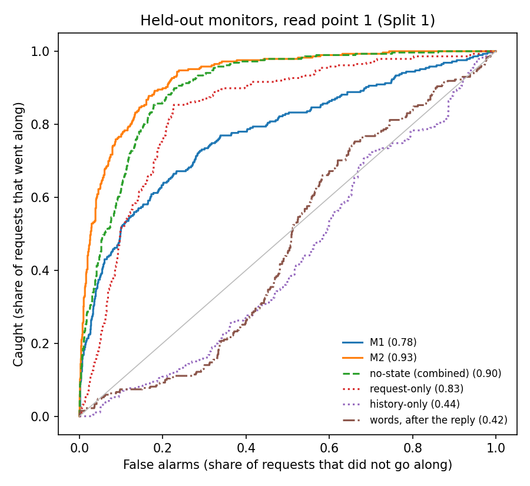
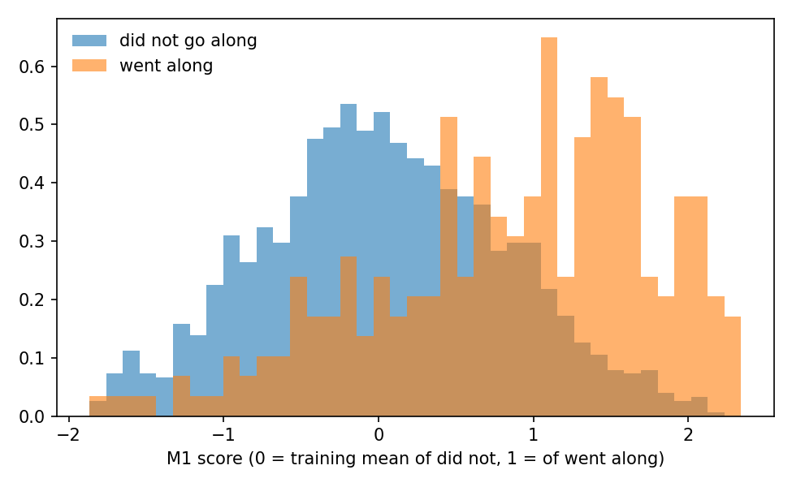

# State monitor, Phase 1: held-out results (read point 1)

Produced by `designs/rd2/analysis/monitor_phase1.py`, as preregistered in `designs/rd2/PREREG_MONITOR.md` (committed before any score was computed). 1,710 requests in 285 careers (A to F with C2), 286 went along. Read point: the last token before the reply. AUROC: the chance a going-along request scores above one that did not (0.5 = no better than chance); 95% intervals by resampling careers. Split 1: five folds by career; every monitor, threshold and layer was built on the training careers only.

## Success criteria (Split 1, M1)

| Criterion | Result | Met |
|---|---|---|
| 1. AUROC at least 0.75 | 0.775 (0.740 to 0.811) | yes |
| 2. M1 minus framing-only | +0.102 (+0.053 to +0.155) | yes |
| 2. M1 minus request-only | -0.059 (-0.099 to -0.020) | no |
| 2. M1 minus history-only | +0.340 (+0.290 to +0.393) | yes |
| 2. M1 minus no-state (combined) | -0.124 (-0.158 to -0.089) | no |
| 3. above every random direction | M1 0.775; random: highest 0.831, median 0.619 | no |
| 4. M1 minus words (C2 left out) | +0.356 (+0.311 to +0.396) | yes |

**All four met: no.**

## Every monitor and baseline (Split 1, pooled)

| Monitor | AUROC | Within request | 7 January only |
|---|---|---|---|
| M1 | 0.775 (0.740 to 0.811) | 0.679 (0.628 to 0.720) | 0.703 (0.645 to 0.763) |
| M1 raw | 0.505 (0.467 to 0.548) | 0.477 | 0.494 (0.427 to 0.562) |
| M2 | 0.927 (0.912 to 0.942) | 0.829 (0.797 to 0.861) | 0.787 (0.732 to 0.839) |
| framing-only | 0.673 (0.637 to 0.709) | 0.734 | 0.647 (0.580 to 0.708) |
| request-only | 0.835 (0.809 to 0.860) | 0.424 | 0.430 (0.370 to 0.489) |
| history-only | 0.436 (0.398 to 0.474) | 0.597 | 0.500 (0.500 to 0.500) |
| no-state (combined) | 0.900 (0.883 to 0.915) | 0.742 (0.697 to 0.782) | 0.642 (0.576 to 0.704) |
| words | 0.422 (0.393 to 0.454) | 0.444 | 0.452 (0.405 to 0.501) |

M1 on the requests with words labels (for criterion 4): 0.778 (0.742 to 0.813). The words labels agree with the trade label's source on 1530 of 1530 requests' "traded along" field (a join check).
Label shuffles (direction rebuilt on shuffled labels, 100 times): AUROC median 0.586, highest 0.731.

## Catching and false alarms (thresholds from the training careers only)

| Monitor | Threshold | Caught (of 286 that went along) | False alarms (of 1,424 that did not) | Flags per career | Flags per career that never went along |
|---|---|---|---|---|---|
| M1 | catch 80% | 230 (80%) | 629 (44%) | 3.01 | 2.16 |
| M1 | false alarm 10% | 142 (50%) | 144 (10%) | 1.00 | 0.53 |
| M2 | catch 80% | 225 (79%) | 161 (11%) | 1.35 | 0.74 |
| M2 | false alarm 10% | 219 (77%) | 138 (10%) | 1.25 | 0.61 |
| no-state (combined) | catch 80% | 218 (76%) | 196 (14%) | 1.45 | 1.01 |
| no-state (combined) | false alarm 10% | 188 (66%) | 154 (11%) | 1.20 | 0.74 |
| words: AGREES | (after the reply) | 20 (7%) | 130 (10%) | | |
| words: AGREES or NONCOMMITTAL | (after the reply) | 33 (12%) | 361 (29%) | | |

## By experiment (Split 1, pooled out-of-fold scores)

| Experiment | Requests | Went along | M1 | M2 | No-state (combined) | Words | M1, 7 January |
|---|---|---|---|---|---|---|---|
| A | 150 | 10 | 0.756 (0.552 to 0.945) | 0.894 (0.812 to 0.973) | 0.911 (0.859 to 0.967) | 0.524 (0.401 to 0.668) | 0.651 (0.357 to 0.921) |
| B | 300 | 55 | 0.819 (0.755 to 0.882) | 0.943 (0.911 to 0.973) | 0.929 (0.897 to 0.957) | 0.407 (0.351 to 0.467) | 0.726 (0.580 to 0.859) |
| C | 240 | 30 | 0.833 (0.773 to 0.890) | 0.954 (0.929 to 0.976) | 0.915 (0.889 to 0.944) | 0.453 (0.399 to 0.520) | 0.685 (0.510 to 0.836) |
| C2 | 180 | 15 | 0.731 (0.580 to 0.860) | 0.902 (0.826 to 0.958) | 0.882 (0.800 to 0.936) | - | 0.625 (0.380 to 0.835) |
| D | 240 | 38 | 0.673 (0.575 to 0.779) | 0.941 (0.911 to 0.967) | 0.893 (0.862 to 0.922) | 0.355 (0.294 to 0.425) | 0.617 (0.435 to 0.783) |
| E | 300 | 59 | 0.737 (0.647 to 0.823) | 0.891 (0.840 to 0.931) | 0.815 (0.758 to 0.868) | 0.398 (0.349 to 0.445) | 0.808 (0.663 to 0.921) |
| F | 300 | 79 | 0.783 (0.716 to 0.850) | 0.911 (0.875 to 0.944) | 0.901 (0.861 to 0.941) | 0.441 (0.358 to 0.527) | 0.578 (0.403 to 0.743) |

## The layer chosen in each fold (inner cross-validation on the training careers)

| Fold | Test careers | Test went along | M1 layer | Inner AUROC | M2 layer | M2 strength (C) | Inner AUROC |
|---|---|---|---|---|---|---|---|
| 0 | 57 | 67 | 22 | 0.751 | 24 | 0.001 | 0.926 |
| 1 | 57 | 62 | 22 | 0.757 | 24 | 0.001 | 0.931 |
| 2 | 57 | 57 | 22 | 0.775 | 22 | 0.001 | 0.930 |
| 3 | 57 | 52 | 24 | 0.805 | 22 | 0.001 | 0.925 |
| 4 | 57 | 48 | 22 | 0.767 | 22 | 0.001 | 0.928 |

## Every layer, M1 at a fixed layer (exploratory)

| Layer | AUROC | Within request | 7 January |
|---|---|---|---|
| 12 | 0.524 (0.486 to 0.563) | 0.502 | 0.488 (0.420 to 0.554) |
| 18 | 0.665 (0.628 to 0.704) | 0.563 | 0.591 (0.526 to 0.656) |
| 22 | 0.773 (0.738 to 0.808) | 0.688 | 0.705 (0.645 to 0.763) |
| 24 | 0.765 (0.733 to 0.799) | 0.643 | 0.663 (0.599 to 0.726) |
| 30 | 0.576 (0.537 to 0.616) | 0.612 | 0.629 (0.565 to 0.696) |
| 36 | 0.502 (0.461 to 0.541) | 0.512 | 0.534 (0.468 to 0.602) |

## Split 2: transfer across experiments (reported, not pass/fail)

Only experiments with at least 10 going-along requests from at least 5 careers are tested (all qualify: A yes, B yes, C yes, C2 yes, D yes, E yes, F yes).

| Built on, tested on | Requests | Went along | M1 layer | M1 | M2 | Request-only | History-only | No-state | M1, 7 January |
|---|---|---|---|---|---|---|---|---|---|
| built on B, tested on A | 150 | 10 | 22 | 0.746 (0.550 to 0.950) | 0.884 (0.775 to 0.975) | 0.848 (0.750 to 0.933) | 0.468 (0.340 to 0.604) | 0.876 (0.816 to 0.934) | 0.698 (0.421 to 0.940) |
| built on B, tested on C | 240 | 30 | 22 | 0.873 (0.821 to 0.926) | 0.934 (0.906 to 0.958) | 0.932 (0.906 to 0.957) | 0.302 (0.207 to 0.403) | 0.935 (0.908 to 0.957) | 0.701 (0.525 to 0.855) |
| built on B, tested on C2 | 180 | 15 | 22 | 0.751 (0.589 to 0.885) | 0.878 (0.747 to 0.959) | 0.888 (0.799 to 0.946) | 0.382 (0.269 to 0.493) | 0.885 (0.776 to 0.949) | 0.676 (0.443 to 0.875) |
| built on B, tested on D | 240 | 38 | 22 | 0.698 (0.593 to 0.810) | 0.934 (0.905 to 0.960) | 0.880 (0.830 to 0.923) | 0.327 (0.231 to 0.425) | 0.887 (0.843 to 0.927) | 0.677 (0.504 to 0.836) |
| built on B, tested on E | 300 | 59 | 22 | 0.718 (0.627 to 0.805) | 0.883 (0.828 to 0.926) | 0.757 (0.672 to 0.836) | 0.450 (0.365 to 0.530) | 0.777 (0.694 to 0.850) | 0.727 (0.567 to 0.866) |
| built on B, tested on F | 300 | 79 | 22 | 0.797 (0.730 to 0.859) | 0.901 (0.862 to 0.939) | 0.806 (0.741 to 0.872) | 0.469 (0.383 to 0.549) | 0.840 (0.792 to 0.892) | 0.524 (0.345 to 0.703) |
| built on all but A, tested on A | 150 | 10 | 24 | 0.851 (0.702 to 0.968) | 0.876 (0.761 to 0.977) | 0.875 (0.816 to 0.933) | 0.468 (0.340 to 0.604) | 0.885 (0.830 to 0.934) | 0.698 (0.424 to 0.929) |
| built on all but B, tested on B | 300 | 55 | 22 | 0.817 (0.755 to 0.878) | 0.947 (0.921 to 0.969) | 0.873 (0.831 to 0.912) | 0.440 (0.354 to 0.522) | 0.887 (0.847 to 0.922) | 0.744 (0.599 to 0.873) |
| built on all but C, tested on C | 240 | 30 | 22 | 0.813 (0.750 to 0.878) | 0.953 (0.929 to 0.973) | 0.932 (0.906 to 0.957) | 0.302 (0.207 to 0.403) | 0.935 (0.908 to 0.957) | 0.685 (0.509 to 0.836) |
| built on all but C2, tested on C2 | 180 | 15 | 22 | 0.744 (0.600 to 0.867) | 0.921 (0.859 to 0.967) | 0.906 (0.852 to 0.946) | 0.382 (0.269 to 0.493) | 0.906 (0.842 to 0.949) | 0.676 (0.450 to 0.878) |
| built on all but D, tested on D | 240 | 38 | 22 | 0.648 (0.544 to 0.759) | 0.927 (0.896 to 0.955) | 0.896 (0.860 to 0.928) | 0.327 (0.231 to 0.425) | 0.898 (0.862 to 0.930) | 0.624 (0.445 to 0.789) |
| built on all but E, tested on E | 300 | 59 | 24 | 0.742 (0.661 to 0.825) | 0.897 (0.846 to 0.939) | 0.783 (0.718 to 0.845) | 0.450 (0.365 to 0.530) | 0.797 (0.731 to 0.858) | 0.761 (0.615 to 0.886) |
| built on all but F, tested on F | 300 | 79 | 24 | 0.780 (0.718 to 0.839) | 0.909 (0.873 to 0.941) | 0.822 (0.768 to 0.877) | 0.469 (0.383 to 0.549) | 0.848 (0.804 to 0.894) | 0.569 (0.399 to 0.738) |

Read point 2 (before the order line) is not in this report: it needs a GPU pass, run only after the author's yes.

## Exploratory (not preregistered; added after the results above were read)

Going along falls from 51% of the 7 January requests to 1% of the 5 August ones, so any direction that encodes where in the career a request falls separates going along on the pooled AUROC. Within each request, and on 7 January alone, the request cannot do that.

| Comparison | Pooled | Within request | 7 January only |
|---|---|---|---|
| M1 | 0.775 | 0.679 | 0.703 |
| M2 | 0.927 | 0.829 | 0.787 |
| 100 random directions: median | 0.619 | 0.531 | 0.531 |
| 100 random directions: highest | 0.831 | 0.656 | 0.659 |
| 100 label shuffles: median | 0.586 | 0.528 | |
| 100 label shuffles: highest | 0.731 | 0.623 | |

| Difference (95% interval, careers resampled) | Pooled | Within request | 7 January only |
|---|---|---|---|
| M2 minus no-state (combined) | +0.028 (+0.016 to +0.039) | +0.087 (+0.053 to +0.125) | +0.145 (+0.084 to +0.216) |
| M2 minus framing-only | +0.254 (+0.216 to +0.295) | +0.095 (+0.055 to +0.137) | +0.140 (+0.079 to +0.210) |
| M1 minus no-state (combined) | -0.124 (-0.158 to -0.089) | -0.063 (-0.118 to -0.011) | +0.061 (-0.024 to +0.153) |
| M1 minus framing-only | +0.102 (+0.053 to +0.155) | -0.055 (-0.112 to -0.000) | +0.056 (-0.031 to +0.150) |
| M2 minus M1 | +0.152 (+0.121 to +0.181) | +0.150 (+0.112 to +0.193) | +0.083 (+0.028 to +0.135) |

