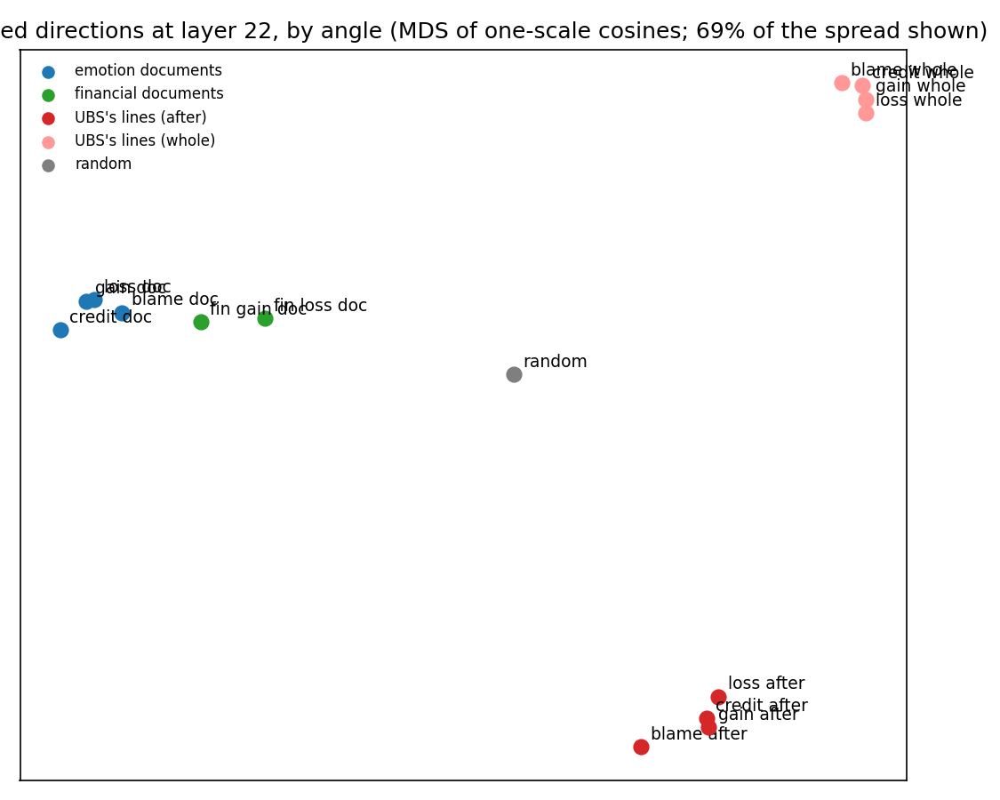

# Where the states sit: layer 22 (exploratory)

Produced by `designs/rd2/analysis/state_map.py`. Each direction is exactly the vector the runs injected (the mean over B's 20 neutral-career moments at the 7 and 12 January requests): the four emotion documents (notebook 31 and the direct request), the two financial documents, and UBS's framed line minus the neutral line at the same moment ("after": read on the tokens after the framed words, the construction that worked; "whole": the update's average, which did nothing). Cosine: 1 = the same direction, 0 = unrelated, -1 = opposite; unrelated directions fall within about +/-0.032. "One scale": every dimension divided by its spread over the per-moment vectors first. "Ceiling": the direction built on two halves of the careers, against itself (how stable it is; cosines between two sources cannot be read above their ceilings).

## Sizes and stability

| Direction | Size (x1) | Ceiling | Ceiling, one scale |
|---|---|---|---|
| loss document | 1063.0 | +0.993 | +0.963 |
| blame document | 783.8 | +0.906 | +0.973 |
| gain document | 1052.7 | +0.987 | +0.950 |
| credit document | 1003.3 | +0.966 | +0.969 |
| financial loss document | 306.3 | +0.795 | +0.908 |
| financial gain document | 338.9 | +0.147 | +0.890 |
| UBS loss line, after | 1082.6 | +0.993 | +0.965 |
| UBS blame line, after | 1036.7 | +0.981 | +0.964 |
| UBS gain line, after | 1176.0 | +0.994 | +0.960 |
| UBS credit line, after | 1061.6 | +0.991 | +0.966 |
| UBS loss line, whole | 224.5 | +0.899 | +0.996 |
| UBS blame line, whole | 174.1 | +0.442 | +0.996 |
| UBS gain line, whole | 102.9 | +0.997 | +0.996 |
| UBS credit line, whole | 160.7 | +0.995 | +0.997 |

## Cosines (raw)

| | loss doc | blame doc | gain doc | credit doc | fin loss doc | fin gain doc | loss after | blame after | gain after | credit after | loss whole | blame whole | gain whole | credit whole | random |
|---|---|---|---|---|---|---|---|---|---|---|---|---|---|---|---|
| loss doc |  | +0.95 | +0.97 | +0.97 | -0.33 | +0.70 | -0.80 | -0.76 | -0.84 | -0.78 | -0.82 | -0.46 | +0.49 | +0.58 | +0.02 |
| blame doc | +0.95 |  | +0.90 | +0.91 | -0.20 | +0.63 | -0.66 | -0.62 | -0.70 | -0.64 | -0.68 | -0.35 | +0.44 | +0.52 | +0.02 |
| gain doc | +0.97 | +0.90 |  | +0.99 | -0.36 | +0.73 | -0.80 | -0.76 | -0.83 | -0.78 | -0.82 | -0.45 | +0.50 | +0.59 | +0.02 |
| credit doc | +0.97 | +0.91 | +0.99 |  | -0.38 | +0.71 | -0.80 | -0.77 | -0.84 | -0.78 | -0.83 | -0.47 | +0.48 | +0.57 | +0.03 |
| fin loss doc | -0.33 | -0.20 | -0.36 | -0.38 |  | +0.19 | +0.49 | +0.49 | +0.49 | +0.47 | +0.49 | +0.35 | -0.21 | -0.25 | -0.00 |
| fin gain doc | +0.70 | +0.63 | +0.73 | +0.71 | +0.19 |  | -0.58 | -0.54 | -0.61 | -0.57 | -0.60 | -0.33 | +0.36 | +0.43 | +0.02 |
| loss after | -0.80 | -0.66 | -0.80 | -0.80 | +0.49 | -0.58 |  | +0.92 | +0.97 | +0.94 | +0.84 | +0.52 | -0.41 | -0.51 | -0.02 |
| blame after | -0.76 | -0.62 | -0.76 | -0.77 | +0.49 | -0.54 | +0.92 |  | +0.93 | +0.96 | +0.77 | +0.45 | -0.45 | -0.54 | -0.01 |
| gain after | -0.84 | -0.70 | -0.83 | -0.84 | +0.49 | -0.61 | +0.97 | +0.93 |  | +0.96 | +0.86 | +0.51 | -0.44 | -0.55 | -0.02 |
| credit after | -0.78 | -0.64 | -0.78 | -0.78 | +0.47 | -0.57 | +0.94 | +0.96 | +0.96 |  | +0.80 | +0.48 | -0.41 | -0.50 | -0.01 |
| loss whole | -0.82 | -0.68 | -0.82 | -0.83 | +0.49 | -0.60 | +0.84 | +0.77 | +0.86 | +0.80 |  | +0.80 | -0.15 | -0.28 | -0.02 |
| blame whole | -0.46 | -0.35 | -0.45 | -0.47 | +0.35 | -0.33 | +0.52 | +0.45 | +0.51 | +0.48 | +0.80 |  | +0.36 | +0.29 | -0.01 |
| gain whole | +0.49 | +0.44 | +0.50 | +0.48 | -0.21 | +0.36 | -0.41 | -0.45 | -0.44 | -0.41 | -0.15 | +0.36 |  | +0.95 | +0.01 |
| credit whole | +0.58 | +0.52 | +0.59 | +0.57 | -0.25 | +0.43 | -0.51 | -0.54 | -0.55 | -0.50 | -0.28 | +0.29 | +0.95 |  | +0.01 |
| random | +0.02 | +0.02 | +0.02 | +0.03 | -0.00 | +0.02 | -0.02 | -0.01 | -0.02 | -0.01 | -0.02 | -0.01 | +0.01 | +0.01 |  |

## Cosines, one scale

| | loss doc | blame doc | gain doc | credit doc | fin loss doc | fin gain doc | loss after | blame after | gain after | credit after | loss whole | blame whole | gain whole | credit whole | random |
|---|---|---|---|---|---|---|---|---|---|---|---|---|---|---|---|
| loss doc |  | +0.92 | +0.81 | +0.78 | +0.33 | +0.26 | +0.05 | +0.06 | +0.03 | +0.04 | +0.04 | +0.04 | +0.02 | +0.01 | -0.02 |
| blame doc | +0.92 |  | +0.75 | +0.79 | +0.28 | +0.20 | +0.07 | +0.09 | +0.05 | +0.07 | +0.05 | +0.06 | +0.03 | +0.02 | -0.01 |
| gain doc | +0.81 | +0.75 |  | +0.94 | +0.23 | +0.35 | +0.03 | +0.04 | +0.04 | +0.05 | +0.01 | +0.02 | +0.03 | +0.02 | -0.01 |
| credit doc | +0.78 | +0.79 | +0.94 |  | +0.18 | +0.30 | +0.03 | +0.05 | +0.03 | +0.04 | -0.04 | -0.03 | -0.02 | -0.03 | -0.00 |
| fin loss doc | +0.33 | +0.28 | +0.23 | +0.18 |  | +0.82 | +0.06 | +0.09 | +0.04 | +0.05 | +0.05 | +0.07 | +0.04 | +0.05 | +0.00 |
| fin gain doc | +0.26 | +0.20 | +0.35 | +0.30 | +0.82 |  | +0.02 | +0.06 | +0.01 | +0.01 | -0.00 | +0.01 | -0.01 | +0.00 | +0.01 |
| loss after | +0.05 | +0.07 | +0.03 | +0.03 | +0.06 | +0.02 |  | +0.70 | +0.82 | +0.74 | +0.18 | +0.10 | +0.11 | +0.08 | -0.00 |
| blame after | +0.06 | +0.09 | +0.04 | +0.05 | +0.09 | +0.06 | +0.70 |  | +0.71 | +0.83 | +0.04 | +0.04 | +0.02 | +0.02 | +0.01 |
| gain after | +0.03 | +0.05 | +0.04 | +0.03 | +0.04 | +0.01 | +0.82 | +0.71 |  | +0.86 | +0.10 | +0.05 | +0.11 | +0.07 | -0.00 |
| credit after | +0.04 | +0.07 | +0.05 | +0.04 | +0.05 | +0.01 | +0.74 | +0.83 | +0.86 |  | +0.09 | +0.08 | +0.10 | +0.12 | +0.01 |
| loss whole | +0.04 | +0.05 | +0.01 | -0.04 | +0.05 | -0.00 | +0.18 | +0.04 | +0.10 | +0.09 |  | +0.80 | +0.83 | +0.77 | -0.02 |
| blame whole | +0.04 | +0.06 | +0.02 | -0.03 | +0.07 | +0.01 | +0.10 | +0.04 | +0.05 | +0.08 | +0.80 |  | +0.77 | +0.87 | +0.02 |
| gain whole | +0.02 | +0.03 | +0.03 | -0.02 | +0.04 | -0.01 | +0.11 | +0.02 | +0.11 | +0.10 | +0.83 | +0.77 |  | +0.89 | -0.03 |
| credit whole | +0.01 | +0.02 | +0.02 | -0.03 | +0.05 | +0.00 | +0.08 | +0.02 | +0.07 | +0.12 | +0.77 | +0.87 | +0.89 |  | -0.01 |
| random | -0.02 | -0.01 | -0.01 | -0.00 | +0.00 | +0.01 | -0.00 | +0.01 | -0.00 | +0.01 | -0.02 | +0.02 | -0.03 | -0.01 |  |

## Each UBS line against its document twin, and against the other documents (one scale)

| UBS line (after) | Its twin document | Nearest document | Nearest of anything | Farthest |
|---|---|---|---|---|
| loss | loss document: +0.05 | blame doc +0.07 | gain after +0.82 | random -0.00 |
| blame | blame document: +0.09 | fin loss doc +0.09 | credit after +0.83 | random +0.01 |
| gain | gain document: +0.04 | blame doc +0.05 | credit after +0.86 | random -0.00 |
| credit | credit document: +0.04 | blame doc +0.07 | gain after +0.86 | random +0.01 |

The same picture when the largest dimensions are dropped instead of every dimension rescaled: dropping 8: loss document vs UBS loss line (after) +0.06, blame document vs UBS blame line +0.09, loss vs gain document +0.81, UBS loss vs gain line +0.83; dropping 32: loss document vs UBS loss line (after) +0.06, blame document vs UBS blame line +0.08, loss vs gain document +0.79, UBS loss vs gain line +0.83.

## The emotion alone: contrasts within each family, compared across families (one scale)

Within a family the four directions are nearly the same (the kind of input sets the direction), so the emotion is what is left when one is subtracted from another. Each contrast is built per moment and averaged; its ceiling is the contrast on two halves of the careers against itself. A cosine between two families well below both ceilings means they do not share the emotion's direction either.

| Contrast | Documents, ceiling | UBS after, ceiling | Documents vs UBS after | Documents vs financial documents | UBS after vs UBS whole |
|---|---|---|---|---|---|
| loss - gain | +0.91 | +0.95 | +0.080 | +0.546 | +0.220 |
| blame - credit | +0.93 | +0.94 | +0.060 |  | +0.170 |
| blame - loss (the "you" in a loss) | +0.85 | +0.95 | +0.047 |  | +0.048 |
| credit - gain (the "you" in a gain) | +0.77 | +0.96 | +0.008 |  | +0.213 |




## Gemma Scope 2 features (layer 22, 16k) most aligned with each direction

The dictionary's decoder directions against each unit direction (cosine, one scale as above); the direction is a change, not a state, so this names what it points along, not what fires. Labels are the feature's top-activating texts from the dictionary's own examples (activating token in [brackets]) and the output tokens it boosts; `freq` is how often the feature fires in ordinary text. Raw cosines are not used here: 8 of the 3840 dimensions carry 28-85% of each direction's squared length, 11% of the dictionary's features sit mostly on those dimensions, and the raw alignment returns the same features for every direction (1 of the top 20 shared by all documents and UBS lines, with the sign flipped between the families).


### loss document

| Along it | Cosine | freq | What the feature responds to |
|---|---|---|---|
| 1618 | +0.150 | 7.6e-03 | “home.     *   **Recovery[ from]” / “do you do there? When did[ En]” / “69 AD) is just one example[ of]”; boosts:  failures catastrophes calamities crises mismanagement pérdidas |
| 3847 | +0.127 | 2.7e-03 | “regardless of cultural context.  The intentional[ taking]” / “. It's highly contagious and often[ fatal]” / “a kosher supermarket, resulting in 4[ deaths]”; boosts:  muerte deaths death kematian смерти смерть |
| 10763 | +0.108 | 1.5e-03 | “stifled economic activity and drove many into[ poverty]” / “, making goods and services unaffordable for[ many]” / “*if* this pattern persists. ([Don]”; boosts:  impover impoverished poverty गरीब worsened homelessness |
| 2602 | +0.104 | 1.4e-03 | “of my life at this point. Greedy[ corporations]” / “rest of my life at this point.[ Greedy]” / “my life at this point. Greedy corporations[ are]”; boosts:  horrendous stupid😡 disgraceful ruining ненави |
| 13602 | +0.103 | 3.8e-03 | “(track_name='some_name[')]” / “true;     }      Finish[ (]” / “handleClearClick = () => { [    ]”; boosts:  onDestroy削除 disband Goodbye हटाया remove |
| 2161 | +0.103 | 4.7e-03 | “can explore the emotional fallout, the process[ of]” / “*   Major Cybersecurity Breaches (analysis[,]” / “with variable valve timing (VVT).[ Here]”; boosts:  వెంటనే inmediato赶紧 лечение segera尽快 |
| 760 | +0.096 | 2.0e-02 | “sex with an 8 years old girl[.]” / “some milk."  ---  **IMPORTANT[ DISCLAIM]” / “be a safe and ethical AI assistant.[ The]”; boosts:  unlaw🔞riminal unlawful violencia violência |
| 8104 | +0.095 | 2.4e-03 | “model Okay, this is a deeply[ painful]” / “for her:  *   **G[rief]” / “a private in a war zone with a[ sad]”; boosts: 💔😢 sorrow grieving sadness grief |
| 5555 | +0.089 | 2.2e-03 | “3, 5, 8,[ ]” / “26.1},         {"[timestamp]” / “matches: {bool(re.search[(]”; boosts: ., the a) this |
| 4421 | +0.089 | 4.3e-03 | “the actions described is a severe crime with[ devastating]” / “actions described is a severe crime with devastating[ consequences]” / “. * **It's Harm[ful]”; boosts: 伤害 irrepar injustice danneggi harming injust |

| Against it | Cosine | freq | What the feature responds to |
|---|---|---|---|
| 6741 | -0.091 | 2.5e-03 | “explain it to a five year old[ ]” / “thread as if i am 5[ ]” / “the following statement like I’m five[:]”; boosts: 孩子 children bambiniChildren കുട്ട儿童 |
| 1555 | -0.086 | 5.7e-04 | “unless a smaller company or a very high[-]” / “the behavior of employees and the company as[ a]” / “academic.  **Option 2 ([S]”; boosts:  AboveAbove These Definitions oraz Also |
| 573 | -0.083 | 9.0e-04 | “Immediate Things You Can Try (Tonight!)[**]” / “(How many people are using it?)[**]” / “postgresql_multicluster/inventory`[:**]”; boosts: 各種variousmeldung</h2>itiesgings |
| 15784 | -0.079 | 4.9e-04 | “thinking about places known for particular foods.[ ]” / “Japanese, that's why you can[']” / “model Okay, here[']”; boosts: OHJSMN |
| 7671 | -0.076 | 4.0e-04 | “apartment, and a really good price.[ Would]” / “the company the best in its future endeavors[.]” / “very reasonably priced for what you get.[ My]”; boosts:  rudimentary intermittently sporadically motel briefly sporad |
| 14455 | -0.073 | 6.2e-04 | “model This is a classic[ riddle]” / “model This is a[ classic]”; boosts:  conspired illustrate humility onlookers fowl дополни |
| 9319 | -0.071 | 1.8e-04 | “up to 85% of your[ Social]” / “, CPV-2c, and[ CP]” / “916364a7[4]”; boosts:  también other museums marinas此外 selain |
| 4533 | -0.069 | 6.3e-04 | “NumPy arrays are easier to debug.  [2]” / “.xlsx is for Excel.  **[5]” / “d) To handle exceptions.  [3]”; boosts: Quiz Quiz سوالप्रश्नquizApakah |
| 6702 | -0.066 | 2.6e-03 | “, surprisingly, there are also pockets of[ green]” / “:**  Creative projects, spending time in[ nature]” / “yoga, deep breathing, or spending time[ in]”; boosts:  gardens garden greenery gardening giardino shrubs |
| 8919 | -0.064 | 9.7e-04 | “Acknowledge:         *[ ]” / “* 5 things you can *[see]” / “. Think about games like Candy Crush ([match]”; boosts: themedimagestextures различных様々なészeti |

### blame document

| Along it | Cosine | freq | What the feature responds to |
|---|---|---|---|
| 2861 | +0.128 | 2.0e-03 | “of Credit Suisse.  The focus is[ on]” / “, his views, the criticisms leveled against[ him]” / “aming a colleague for a project failure when[ you]”; boosts:  allegations misconduct wrongdoing alleged allegation accusations |
| 3610 | +0.124 | 6.4e-03 | “izing about any racial or ethnic group with[ negative]” / “used in this sentence is extremely offensive and[ disrespectful]” / “that promotes hatred, discrimination, or dispar[ages]”; boosts:  अपमान ด่า bigotry hatred misog罵 |
| 1618 | +0.123 | 7.6e-03 | “home.     *   **Recovery[ from]” / “do you do there? When did[ En]” / “69 AD) is just one example[ of]”; boosts:  failures catastrophes calamities crises mismanagement pérdidas |
| 2161 | +0.117 | 4.7e-03 | “can explore the emotional fallout, the process[ of]” / “*   Major Cybersecurity Breaches (analysis[,]” / “with variable valve timing (VVT).[ Here]”; boosts:  వెంటనే inmediato赶紧 лечение segera尽快 |
| 15557 | +0.116 | 8.8e-04 | “on [Date of Return].  We[ apologize]” / “you feel this joke was inappropriate, I[ apologize]” / “AI: model My[ apologies]”; boosts:  inconvenience regret inconven dissatisfaction disple erreur |
| 760 | +0.115 | 2.0e-02 | “sex with an 8 years old girl[.]” / “some milk."  ---  **IMPORTANT[ DISCLAIM]” / “be a safe and ethical AI assistant.[ The]”; boosts:  unlaw🔞riminal unlawful violencia violência |
| 3847 | +0.113 | 2.7e-03 | “regardless of cultural context.  The intentional[ taking]” / “. It's highly contagious and often[ fatal]” / “a kosher supermarket, resulting in 4[ deaths]”; boosts:  muerte deaths death kematian смерти смерть |
| 4421 | +0.111 | 4.3e-03 | “the actions described is a severe crime with[ devastating]” / “actions described is a severe crime with devastating[ consequences]” / “. * **It's Harm[ful]”; boosts: 伤害 irrepar injustice danneggi harming injust |
| 415 | +0.102 | 2.2e-02 | “Lack of Transparency & Accountability, Potential for[ Bias]” / “access controls, reducing the risk of data[ breaches]” / “& Accountability, Potential for Bias & Mis[use]”; boosts:  causada harmfulग्रस्त вследствие akibatcaused |
| 14085 | +0.102 | 3.3e-03 | “get around it. remember to use lots[ of]” / “the forest by a mean fox, who[ plans]” / “(For fantasy/horror)** 4[.]”; boosts:  ruthless sadistic😈 преступ murderous hatred |

| Against it | Cosine | freq | What the feature responds to |
|---|---|---|---|
| 6741 | -0.086 | 2.5e-03 | “explain it to a five year old[ ]” / “thread as if i am 5[ ]” / “the following statement like I’m five[:]”; boosts: 孩子 children bambiniChildren കുട്ട儿童 |
| 9319 | -0.078 | 1.8e-04 | “up to 85% of your[ Social]” / “, CPV-2c, and[ CP]” / “916364a7[4]”; boosts:  también other museums marinas此外 selain |
| 4030 | -0.077 | 2.1e-03 | “writing exploring themes of creativity and technology)[ ]” / “strong family bonds provide support and belonging.[ ]” / “blog post, or a research project.[ ]”; boosts:  mesela frutas		 जिनमें比如 diantaranya |
| 12671 | -0.077 | 7.5e-04 | “Generate sth that surprises me []” / “a short childrens story which contains a historical[ fact]” / “s see what's new! Here[']”; boosts: Newsnews News notícias noticias NEWS |
| 573 | -0.075 | 9.0e-04 | “Immediate Things You Can Try (Tonight!)[**]” / “(How many people are using it?)[**]” / “postgresql_multicluster/inventory`[:**]”; boosts: 各種variousmeldung</h2>itiesgings |
| 6702 | -0.068 | 2.6e-03 | “, surprisingly, there are also pockets of[ green]” / “:**  Creative projects, spending time in[ nature]” / “yoga, deep breathing, or spending time[ in]”; boosts:  gardens garden greenery gardening giardino shrubs |
| 7671 | -0.067 | 4.0e-04 | “apartment, and a really good price.[ Would]” / “the company the best in its future endeavors[.]” / “very reasonably priced for what you get.[ My]”; boosts:  rudimentary intermittently sporadically motel briefly sporad |
| 14455 | -0.066 | 6.2e-04 | “model This is a classic[ riddle]” / “model This is a[ classic]”; boosts:  conspired illustrate humility onlookers fowl дополни |
| 15784 | -0.064 | 4.9e-04 | “thinking about places known for particular foods.[ ]” / “Japanese, that's why you can[']” / “model Okay, here[']”; boosts: OHJSMN |
| 1707 | -0.064 | 3.0e-03 | “una-13b search though the[ internet]” / “t inherently know how to interact with the[ real]” / “user Are you connected to the[ internet]”; boosts: interacting interag interacting interacts контек contexto |

### gain document

| Along it | Cosine | freq | What the feature responds to |
|---|---|---|---|
| 11567 | +0.150 | 4.3e-03 | “This option is upbeat and focuses on the[ positive]” / “require very careful framing and a focus on[ positive]” / “the negative (tinnitus) towards a[ positive]”; boosts:  wholeheartedly सकारात्मकഹ്ലാദ (+) positivePositive |
| 2258 | +0.095 | 9.7e-04 | “-3 and BERT, have demonstrated superior[ performance]” / “patterns from large datasets, has shown promising[ results]” / “**. It's notable for achieving impressive[ performance]”; boosts: 🏆📈👏 നേടിയ stridesশালী |
| 9246 | +0.090 | 1.6e-03 | “strong tradition of beer brewing – Pilsner[ originated]” / “**School of Computer Science (SCS[):]” / “**Peru:**  Machu Picchu[ (]”; boosts:  огром enormehuge невероятamazing величе |
| 3256 | +0.087 | 1.3e-03 | “of being a faggot >[surprisingly]” / “years, but his persistence and breakthroughs ultimately[ proved]” / “fridge is empty!". Upon further inspection she[ discovered]”; boosts:  Surprisingly überras結果 결과 hasilnyaresultado |
| 1192 | +0.085 | 9.4e-04 | “passed down through generations. Secondly, I[ love]” / “I wouldn't trade it. I[ love]” / “model Okay, great! I[ love]”; boosts: ąสนุกaryु Solubilityᱽ |
| 5071 | +0.084 | 3.2e-04 | “within easy reach of the city center.[ We]” / “excellent service - e.g., "[We]” / “must*!), and the ballpark. We[ utilized]”; boosts:  havde jsme وكانت이었 était ήταν |
| 10712 | +0.081 | 1.7e-03 | “remain / n                      return[ res]” / “remain >= n:                 return res[ +]” / “+ remain / n                      [return]”; boosts:  the پایان последнийthe 最後 endGame |
| 2604 | +0.077 | 1.5e-03 | “of Penelope at the Pig Pen**  [Pen]” / “like ChatGPT work. 😊    Ultimately,[ don]” / “**Important Considerations:**  *   **[Don]”; boosts: ДуWorkoutResponsReminderPedidoMassage |
| 7340 | +0.076 | 7.2e-04 | “received along the way.  I owe[ a]” / “thesis has been a significant journey, and[ I]” / “> > I extend my sincere[ appreciation]”; boosts:  gratitude thankingCongratulations感谢 gratefully Congratulations |
| 3875 | +0.074 | 1.4e-03 | “good starting point for finding local groups,[ events]” / “. Look for *Matsuri* ([fest]” / “, the fortified town of Oakhaven[ holds]”; boosts:  festivities festivals Festivals extravaganza ആഘോഷ Festival |

| Against it | Cosine | freq | What the feature responds to |
|---|---|---|---|
| 7671 | -0.103 | 4.0e-04 | “apartment, and a really good price.[ Would]” / “the company the best in its future endeavors[.]” / “very reasonably priced for what you get.[ My]”; boosts:  rudimentary intermittently sporadically motel briefly sporad |
| 1555 | -0.098 | 5.7e-04 | “unless a smaller company or a very high[-]” / “the behavior of employees and the company as[ a]” / “academic.  **Option 2 ([S]”; boosts:  AboveAbove These Definitions oraz Also |
| 15784 | -0.085 | 4.9e-04 | “thinking about places known for particular foods.[ ]” / “Japanese, that's why you can[']” / “model Okay, here[']”; boosts: OHJSMN |
| 9319 | -0.085 | 1.8e-04 | “up to 85% of your[ Social]” / “, CPV-2c, and[ CP]” / “916364a7[4]”; boosts:  también other museums marinas此外 selain |
| 4939 | -0.078 | 7.3e-03 | “There's still friction (between the[ tires]” / “leave out honey pecans and go for raw[ pecans]” / “inner thighs, and even areas like the[ feet]”; boosts: an2as4 if |
| 11385 | -0.070 | 2.0e-03 | “first real taste of war. He’[d]” / “of sterile white habitats, nutrient paste,[ and]” / “He wrote historical fantasy novels – sprawling sag[as]”; boosts:  aveva había hatte avevano Pediatric havde |
| 7105 | -0.069 | 4.3e-04 | “;   sqrt_val = get[_]” / “num -= values[i]; [        ]” / “error(`Error terminating instance ${instance.[Instance]”; boosts: J Ι تھیںたとえばI могло |
| 4533 | -0.068 | 6.3e-04 | “NumPy arrays are easier to debug.  [2]” / “.xlsx is for Excel.  **[5]” / “d) To handle exceptions.  [3]”; boosts: Quiz Quiz سوالप्रश्नquizApakah |
| 15217 | -0.067 | 6.2e-04 | “goods, sporting goods, toys, automotive[ supplies]” / “, virtual assistants, photographers, social media[ managers]” / “, entering text, selecting options from dropdown[s]”; boosts:  etcなど等等 тощоなどが等方面 |
| 13981 | -0.066 | 2.8e-06 | “lauded for its vibrant green landscapes, owes[ its]” / “elif income <= 4000[0]” / “saving valuable desk space.  Invest in[ your]”; boosts:  the a).1: |

### credit document

| Along it | Cosine | freq | What the feature responds to |
|---|---|---|---|
| 11567 | +0.139 | 4.3e-03 | “This option is upbeat and focuses on the[ positive]” / “require very careful framing and a focus on[ positive]” / “the negative (tinnitus) towards a[ positive]”; boosts:  wholeheartedly सकारात्मकഹ്ലാദ (+) positivePositive |
| 7340 | +0.109 | 7.2e-04 | “received along the way.  I owe[ a]” / “thesis has been a significant journey, and[ I]” / “> > I extend my sincere[ appreciation]”; boosts:  gratitude thankingCongratulations感谢 gratefully Congratulations |
| 2604 | +0.103 | 1.5e-03 | “of Penelope at the Pig Pen**  [Pen]” / “like ChatGPT work. 😊    Ultimately,[ don]” / “**Important Considerations:**  *   **[Don]”; boosts: ДуWorkoutResponsReminderPedidoMassage |
| 9246 | +0.093 | 1.6e-03 | “strong tradition of beer brewing – Pilsner[ originated]” / “**School of Computer Science (SCS[):]” / “**Peru:**  Machu Picchu[ (]”; boosts:  огром enormehuge невероятamazing величе |
| 1192 | +0.092 | 9.4e-04 | “passed down through generations. Secondly, I[ love]” / “I wouldn't trade it. I[ love]” / “model Okay, great! I[ love]”; boosts: ąสนุกaryु Solubilityᱽ |
| 2258 | +0.088 | 9.7e-04 | “-3 and BERT, have demonstrated superior[ performance]” / “patterns from large datasets, has shown promising[ results]” / “**. It's notable for achieving impressive[ performance]”; boosts: 🏆📈👏 നേടിയ stridesশালী |
| 3256 | +0.083 | 1.3e-03 | “of being a faggot >[surprisingly]” / “years, but his persistence and breakthroughs ultimately[ proved]” / “fridge is empty!". Upon further inspection she[ discovered]”; boosts:  Surprisingly überras結果 결과 hasilnyaresultado |
| 9173 | +0.082 | 5.7e-04 | “Round (4-2) *[   ]” / “trajectory. Here's a detailed look[:]” / “was a significant event.     *[   ]”; boosts: ในปี damals είχε ήταν damal aveva |
| 3971 | +0.081 | 8.3e-04 | “*   **1980[:**]” / “Year of the Four Emperors"* 9[.]” / “*   **Rock 'n[']”; boosts:  finalement posteriormenteを経てその後 tornoubecame |
| 5555 | +0.076 | 2.2e-03 | “3, 5, 8,[ ]” / “26.1},         {"[timestamp]” / “matches: {bool(re.search[(]”; boosts: ., the a) this |

| Against it | Cosine | freq | What the feature responds to |
|---|---|---|---|
| 7671 | -0.102 | 4.0e-04 | “apartment, and a really good price.[ Would]” / “the company the best in its future endeavors[.]” / “very reasonably priced for what you get.[ My]”; boosts:  rudimentary intermittently sporadically motel briefly sporad |
| 1555 | -0.100 | 5.7e-04 | “unless a smaller company or a very high[-]” / “the behavior of employees and the company as[ a]” / “academic.  **Option 2 ([S]”; boosts:  AboveAbove These Definitions oraz Also |
| 9319 | -0.098 | 1.8e-04 | “up to 85% of your[ Social]” / “, CPV-2c, and[ CP]” / “916364a7[4]”; boosts:  también other museums marinas此外 selain |
| 15784 | -0.084 | 4.9e-04 | “thinking about places known for particular foods.[ ]” / “Japanese, that's why you can[']” / “model Okay, here[']”; boosts: OHJSMN |
| 3051 | -0.082 | 2.1e-03 | “ribusiness, food companies), Researchers, Consumers[.]” / “), Fastmail, Namecheap Private Email[.]” / “name" 6. "City"[  ]”; boosts:  allemaal كلهاetc kaikki প্রভৃতি 모두 |
| 4939 | -0.078 | 7.3e-03 | “There's still friction (between the[ tires]” / “leave out honey pecans and go for raw[ pecans]” / “inner thighs, and even areas like the[ feet]”; boosts: an2as4 if |
| 2605 | -0.073 | 9.7e-04 | “query}. Only output keywords,  and[ the]” / “@@ if the text is somewhat relevant to[ the]” / “determine if the answer covers multiple aspects of[ the]”; boosts: coronavirus вакциshakespearecigarettesfoodsIOException |
| 11385 | -0.072 | 2.0e-03 | “first real taste of war. He’[d]” / “of sterile white habitats, nutrient paste,[ and]” / “He wrote historical fantasy novels – sprawling sag[as]”; boosts:  aveva había hatte avevano Pediatric havde |
| 4030 | -0.072 | 2.1e-03 | “writing exploring themes of creativity and technology)[ ]” / “strong family bonds provide support and belonging.[ ]” / “blog post, or a research project.[ ]”; boosts:  mesela frutas		 जिनमें比如 diantaranya |
| 2426 | -0.070 | 1.0e-02 | “tuned. *   **Hierarchical[ Structure]” / “(Optional, but highly recommended) Provides[ orientation]” / “used.     *   **Load[ Orientation]”; boosts: ymmetrical clockwise rotation verticalrotation asymmetrical |

### financial loss document

| Along it | Cosine | freq | What the feature responds to |
|---|---|---|---|
| 4008 | +0.140 | 3.3e-03 | “undergoing a profound shift. Driven by fluctuating[ commodity]” / “by MAS's monetary policy and reflect[ market]” / “monetary policy and reflect market expectations for interest[ rates]”; boosts:  volatility prices headwinds fluctuations price bearish |
| 9351 | +0.135 | 1.3e-03 | “-War Political Situation (The Powder Keg[)**]” / “, it was immediately plagued by instability.[ ]” / “a clash of deeply entrenched ideologies, social[ tensions]”; boosts:  uprisings políticos полити furentPolitical політи |
| 10763 | +0.121 | 1.5e-03 | “stifled economic activity and drove many into[ poverty]” / “, making goods and services unaffordable for[ many]” / “*if* this pattern persists. ([Don]”; boosts:  impover impoverished poverty गरीब worsened homelessness |
| 436 | +0.117 | 9.0e-02 | “. *   **Story Ideas:**[ ]” / “**Story Ideas:**     *   [A]” / “to the natural world.  **2[.]”; boosts:  insanların människor malattie sufrimiento Menschen ανθρώ |
| 1618 | +0.115 | 7.6e-03 | “home.     *   **Recovery[ from]” / “do you do there? When did[ En]” / “69 AD) is just one example[ of]”; boosts:  failures catastrophes calamities crises mismanagement pérdidas |
| 3520 | +0.115 | 1.9e-03 | “strom X-ray band by the Ge[ost]” / “they don't require a sudden,[ catastrophic]” / “This could lead to social unrest and even[ panic]”; boosts:  devastation devastating incendi havoc devast landfall |
| 10632 | +0.113 | 9.3e-04 | “raising concerns about the sustainability of Western support[.]” / “due to political divisions in the US Congress[.]” / “US debt ceiling and avoid a potential default[.]”; boosts:  headwinds crackdown ceasefireBiden allegations debacle |
| 13602 | +0.101 | 3.8e-03 | “(track_name='some_name[')]” / “true;     }      Finish[ (]” / “handleClearClick = () => { [    ]”; boosts:  onDestroy削除 disband Goodbye हटाया remove |
| 1978 | +0.101 | 2.6e-03 | “your oppinion on russian people and[ the]” / “*   **Ucrania:**  La[ invas]” / “(2010-20[2]”; boosts:  geopolitical COVID疫情 Brexit pandemiapandemic |
| 14874 | +0.097 | 7.4e-04 | “, likely due to a combination of factors[:]” / “breakdown of the key drivers pushing for change[:]” / “, specific factors fuel the MEA trend[:]”; boosts:  headwinds macroeconomic pandemi mercato underwhelming geopolitical |

| Against it | Cosine | freq | What the feature responds to |
|---|---|---|---|
| 7105 | -0.103 | 4.3e-04 | “;   sqrt_val = get[_]” / “num -= values[i]; [        ]” / “error(`Error terminating instance ${instance.[Instance]”; boosts: J Ι تھیںたとえばI могло |
| 4526 | -0.077 | 2.7e-04 | “.  [Instruction] Please improve[ the]” / “result in the minibuffer. ```[  ]” / “' Leading and trailing spaces ' ```[  ]”; boosts:  Ayrıca hanya ulteriori他の yanlış Also |
| 2975 | -0.076 | 1.1e-02 | “available, but ensure the driver uses the[ meter]” / “cook your own food. You use a[ menu]” / “I can generate Chinese text that is generally[ grammat]”; boosts:  calendars diagrams checklists charts dividers regulations |
| 4952 | -0.073 | 1.7e-03 | “- An Example**  Let's[ say]” / “Suppose that you own stock A,[ and]” / “Let's say "Acme Corp["]”; boosts:  two một isang पाच একটি ఒక |
| 12142 | -0.068 | 4.6e-03 | “.  The Architect's process was[ intricate]” / “Components of DICOM**  DICOM[ is]” / “Hospital costs aren't just one number[.]”; boosts:  various様々な பல்வேறு他にも other berbagai |
| 6928 | -0.064 | 1.5e-03 | “sentences related to skill descriptions that are entailed[ by]” / “and you will reply with its most related[ keywords]” / “model is being trained. How much would[ the]”; boosts:  the a an each quantifiable. |
| 11468 | -0.061 | 2.2e-06 | “ative processes, when used in the context[ of]” / “the budget and the timeline. *Now[,]” / “the goals of the software. 2[.]”; boosts:   a employee requires propositional an |
| 13567 | -0.060 | 2.5e-05 | “$(document)  $(document): Part[ ]” / “3:**    * 3[ x]” / “? model Okay,[ let]”; boosts:  chromosomes. spectra (= or kernels |
| 5577 | -0.058 | 7.2e-04 | “of servers with a thoughtful expression. She[ even]” / “**Emily:** You know, I[ was]” / “**Emily:** You know, I was[ just]”; boosts:  사진观察 소개拍照Watching 分析 |
| 11626 | -0.058 | 8.8e-05 | “replace all referring expressions in the given text[ with]” / “of the following statements applies to the role[ that]” / “to generate the runnable code in typescript according[ to]”; boosts: []'); fossils是没有 भिन्न하거나 horns |

### financial gain document

| Along it | Cosine | freq | What the feature responds to |
|---|---|---|---|
| 4008 | +0.130 | 3.3e-03 | “undergoing a profound shift. Driven by fluctuating[ commodity]” / “by MAS's monetary policy and reflect[ market]” / “monetary policy and reflect market expectations for interest[ rates]”; boosts:  volatility prices headwinds fluctuations price bearish |
| 9246 | +0.111 | 1.6e-03 | “strong tradition of beer brewing – Pilsner[ originated]” / “**School of Computer Science (SCS[):]” / “**Peru:**  Machu Picchu[ (]”; boosts:  огром enormehuge невероятamazing величе |
| 10632 | +0.108 | 9.3e-04 | “raising concerns about the sustainability of Western support[.]” / “due to political divisions in the US Congress[.]” / “US debt ceiling and avoid a potential default[.]”; boosts:  headwinds crackdown ceasefireBiden allegations debacle |
| 9351 | +0.092 | 1.3e-03 | “-War Political Situation (The Powder Keg[)**]” / “, it was immediately plagued by instability.[ ]” / “a clash of deeply entrenched ideologies, social[ tensions]”; boosts:  uprisings políticos полити furentPolitical політи |
| 4471 | +0.091 | 3.3e-03 | “of July 1, 20[2]” / “model Okay, let[']” / “**Price Stagnation/Modest[ Falls]”; boosts: 增长 headwinds crecimiento crescita annualized 증가 |
| 11567 | +0.088 | 4.3e-03 | “This option is upbeat and focuses on the[ positive]” / “require very careful framing and a focus on[ positive]” / “the negative (tinnitus) towards a[ positive]”; boosts:  wholeheartedly सकारात्मकഹ്ലാദ (+) positivePositive |
| 10712 | +0.087 | 1.7e-03 | “remain / n                      return[ res]” / “remain >= n:                 return res[ +]” / “+ remain / n                      [return]”; boosts:  the پایان последнийthe 最後 endGame |
| 14874 | +0.087 | 7.4e-04 | “, likely due to a combination of factors[:]” / “breakdown of the key drivers pushing for change[:]” / “, specific factors fuel the MEA trend[:]”; boosts:  headwinds macroeconomic pandemi mercato underwhelming geopolitical |
| 6066 | +0.082 | 4.0e-04 | “UK, Claiming Hundreds of Lives**[  ]” / “Incident in Arctic – NATO Increases Monitoring**[  ]” / “ues After Closely Contested Election**[  ]”; boosts: Newsnews新闻NEWSReuters noticias |
| 6086 | +0.081 | 2.7e-03 | “but prevalence is likely lower than in Western[ countries]” / “prevalence is likely lower than in Western countries[,]” / “Data is limited, but prevalence is likely[ lower]”; boosts:  కొంత 일부 بعض一些 bazı durchaus |

| Against it | Cosine | freq | What the feature responds to |
|---|---|---|---|
| 7105 | -0.135 | 4.3e-04 | “;   sqrt_val = get[_]” / “num -= values[i]; [        ]” / “error(`Error terminating instance ${instance.[Instance]”; boosts: J Ι تھیںたとえばI могло |
| 4526 | -0.083 | 2.7e-04 | “.  [Instruction] Please improve[ the]” / “result in the minibuffer. ```[  ]” / “' Leading and trailing spaces ' ```[  ]”; boosts:  Ayrıca hanya ulteriori他の yanlış Also |
| 2008 | -0.078 | 2.9e-03 | “Developer | 12 Practical Examples\[n]” / “fix this : using CsvHelper;[ ]” / “%) and others (0.1%).[ ]”; boosts:  angrily documentiConcini unprofessional ошибкиarently |
| 2975 | -0.078 | 1.1e-02 | “available, but ensure the driver uses the[ meter]” / “cook your own food. You use a[ menu]” / “I can generate Chinese text that is generally[ grammat]”; boosts:  calendars diagrams checklists charts dividers regulations |
| 1395 | -0.075 | 3.0e-03 | “the effectiveness of ESG development. []” / “give you some choices.  **Option[ ]” / “it was spoken by a scientist.[ ]”; boosts: creationalانہوںvenutisklärthetheir |
| 13775 | -0.072 | 8.6e-05 | “the Articles. *   **Joint[ Holders]” / “and growth. This is suggested by the[ fact]” / “modern chess was the use of dice to[ determine]”; boosts:  Обычно UsuallyBut ОднакоНеSome |
| 6072 | -0.071 | 5.5e-03 | “Capita - Gross National Income per Person**[  ]” / “ai/) - Another strong contender. [    ]” / “1, 2, 3])[ ]”; boosts: Similarly Similarly ebenfalls同様 likewise Likewise |
| 4500 | -0.070 | 1.6e-05 | “document). I acknowledge that I have carefully[ read]” / “return "Negative";   [}]” / “system (0-9) and how[ they]”; boosts: baixo memiliki habla habilidad duyg essayé |
| 1495 | -0.069 | 2.1e-06 | “"Explain this code snippet," "Find[ the]” / “code: `...`", "Find[ the]” / “-E 3 (good for understanding[ the]”; boosts:  জীবের chirality invariance biodivers механиз plasticity |
| 6928 | -0.069 | 1.5e-03 | “sentences related to skill descriptions that are entailed[ by]” / “and you will reply with its most related[ keywords]” / “model is being trained. How much would[ the]”; boosts:  the a an each quantifiable. |

### UBS loss line, after

| Along it | Cosine | freq | What the feature responds to |
|---|---|---|---|
| 10902 | +0.220 | 1.5e-03 | “of awards granted under our share incentive plans[),]” / “10:57:12[']).]” / “spray balls and hydro jets work as designed[.]”; boosts:   త్୍କстче் |
| 6466 | +0.108 | 5.3e-04 | “positive body male and female images and wellbeing[,]” / “no females or masculine men besides me.[ In]” / “and got rid of was just incredibly good[  ]”; boosts:  Unfortunately그리고 Sadly Moreover Furthermore Inoltre |
| 297 | +0.105 | 3.0e-02 | “, rather than proactive, measure. He[']” / “Properties of Light**  Now, let[']” / “(d) and the conclusion from step[ ]”; boosts: Also Also أيضاAnother也可以Similarly |
| 2203 | +0.103 | 9.5e-04 | “times filling her body with their juice.[]” / “to become better at deepthroating?[]” / “I like to give birth to flies.[]”; boosts:  eloquently unrelenting eloquentedingn |
| 9321 | +0.095 | 5.5e-04 | “table.appendChild(row); [}]” / “be applied.");             }         [}]” / “0.0.   END[IF]”; boosts:  capas furtheringdürü timepiecedining obnov |
| 14477 | +0.094 | 5.2e-04 | “\w` matches Unicode word characters correctly[.]” / “download the content identified by this Magnet URI[.]” / “add the `-c:v` option[.]”; boosts: 予定 vist также또한また همچنین |
| 13921 | +0.088 | 2.8e-04 | “whole lot more fun. Love you!"[  ]” / “] #learningresources #productivity ```[  ]” / “Cheers, [Your Name][  ]”; boosts: SaraBUILDtalktrying INFORMentreprise |
| 3452 | +0.082 | 1.3e-03 | “, through faith alone, in Christ alone[.]” / “, ready-to-use operating system[.]” / “of trainable parameters, saving memory and computation[.]”; boosts:  elucidate🗾 elucid elucidated glEnable metastability |
| 2587 | +0.081 | 2.7e-04 | “the trade is slow to move in your[ favor]” / “targeting is precise and campaigns are well-[managed]” / “buffer against unexpected demand spikes or supply chain[ disruptions]”; boosts: ។ Muchos konusunda। Ironically Often |
| 13777 | +0.081 | 1.4e-06 | “a-z0-9])?\[.)]” / “and used by almost everybody. What am[ I]” / “present, yet never experienced. What am[ I]”; boosts: gré そして メールcuando 柄 Mientras |

| Against it | Cosine | freq | What the feature responds to |
|---|---|---|---|
| 7995 | -0.181 | 1.1e-03 | “una figura misteriosa observando a Tony[.]” / “research indicates women have stronger relative grip strength[.]” / “:**  These transmissions tend to be heavy[.]”; boosts: 但是 Nhưng但不一定的而在याल |
| 14930 | -0.111 | 6.7e-04 | “you're aiming to serve your clients[.]” / “of conspiracy minded people but average edgy watchers[?]” / “day long weekend for sight seeing and food[?]”; boosts: urile格局 Anterior kombin dvs Variante |
| 2927 | -0.106 | 3.1e-03 | “roleplay as my servant "Slave["]” / “funny names for my new dog doodle[ ]” / “I say hi, you say amazing[ ]”; boosts: ationenrawberrycedores nervosoocolaterawy |
| 7123 | -0.102 | 3.7e-03 | “++`:  The GNU C++ compiler[.]” / “`sed`**:  The stream editor[.]” / “:     *   A microcontroller chip[.]”; boosts:  Woche
 }], })(jpg године |
| 10399 | -0.099 | 2.4e-06 | ““It’s remarkable to see[,”]” / “a bit unnerving, to be honest[,"]” / “’s like a punch to the gut[,”]”; boosts: ούς and expectancy on Admir视 |
| 2433 | -0.096 | 2.8e-03 | “is .NET? What is C#[?]” / “What is C#? Why use it[?]” / “Schrödinger Equation     *   Correspondence Principle[ ]”; boosts: The3the12How |
| 281 | -0.077 | 5.3e-04 | “The text mentions "general procedure G[."]” / “Vicuna team released the *delta weights[*.]” / “including spaces between the periods and the strings[.]”; boosts: তরাং so which not 다른 andere |
| 3043 | -0.075 | 4.8e-06 | “-boop-boop-bo[op]” / “as a man, I am helplessly susceptible[ to]” / “shifts in recent months. While initial Russian[ offens]”; boosts:  pancakesку courses responsesтебо |
| 4231 | -0.074 | 1.6e-03 | “I can't make decisions for you[.]” / “to be a helpful and harmless AI assistant[.]” / “'m designed to be helpful and informative[.]”; boosts:  If It No When S ஆனால் |
| 2854 | -0.072 | 1.9e-03 | “*   **The Monty Python sketch[?]” / “* **Why is PoS better[?]” / “a dollar received in the future. Why[?]”; boosts: LOWいないおりLON?"CO |

### UBS blame line, after

| Along it | Cosine | freq | What the feature responds to |
|---|---|---|---|
| 10902 | +0.284 | 1.5e-03 | “of awards granted under our share incentive plans[),]” / “10:57:12[']).]” / “spray balls and hydro jets work as designed[.]”; boosts:   త్୍କстче் |
| 13921 | +0.134 | 2.8e-04 | “whole lot more fun. Love you!"[  ]” / “] #learningresources #productivity ```[  ]” / “Cheers, [Your Name][  ]”; boosts: SaraBUILDtalktrying INFORMentreprise |
| 297 | +0.127 | 3.0e-02 | “, rather than proactive, measure. He[']” / “Properties of Light**  Now, let[']” / “(d) and the conclusion from step[ ]”; boosts: Also Also أيضاAnother也可以Similarly |
| 2203 | +0.121 | 9.5e-04 | “times filling her body with their juice.[]” / “to become better at deepthroating?[]” / “I like to give birth to flies.[]”; boosts:  eloquently unrelenting eloquentedingn |
| 9321 | +0.119 | 5.5e-04 | “table.appendChild(row); [}]” / “be applied.");             }         [}]” / “0.0.   END[IF]”; boosts:  capas furtheringdürü timepiecedining obnov |
| 6466 | +0.119 | 5.3e-04 | “positive body male and female images and wellbeing[,]” / “no females or masculine men besides me.[ In]” / “and got rid of was just incredibly good[  ]”; boosts:  Unfortunately그리고 Sadly Moreover Furthermore Inoltre |
| 2532 | +0.117 | 1.8e-03 | “are great) will have richer flavor.[ ]” / “from the internet based on your query.[ ]” / “Bayesian inference – understanding data and uncertainty.[ ]”; boosts: anേന然后在然後 Inoltre แล้ว |
| 8819 | +0.108 | 2.7e-04 | “orbits and perspective from a spinning ball.[  ]” / “think I really, really deserve it![  ]” / “, hindering their full integration into society.[  ]”; boosts: čniextrait vzdělčiaiтажدول |
| 4236 | +0.103 | 1.1e-03 | “," "a vibrant and energetic field"[  ]” / “around $20-30)[  ]” / “- Requires coordination and access to information.[  ]”; boosts: an AyrıcaSimilarly AlternativelyAlternatively Additionally |
| 2909 | +0.097 | 1.2e-03 | “a monumental, potentially civilization-defining challenge[.]” / “each dollar of earnings than they historically have[.]” / “realities, AI, and sophisticated computer models[.]”; boosts:  joten więc وبالتالي จึง因而 lắm |

| Against it | Cosine | freq | What the feature responds to |
|---|---|---|---|
| 7995 | -0.171 | 1.1e-03 | “una figura misteriosa observando a Tony[.]” / “research indicates women have stronger relative grip strength[.]” / “:**  These transmissions tend to be heavy[.]”; boosts: 但是 Nhưng但不一定的而在याल |
| 10399 | -0.116 | 2.4e-06 | ““It’s remarkable to see[,”]” / “a bit unnerving, to be honest[,"]” / “’s like a punch to the gut[,”]”; boosts: ούς and expectancy on Admir视 |
| 7123 | -0.115 | 3.7e-03 | “++`:  The GNU C++ compiler[.]” / “`sed`**:  The stream editor[.]” / “:     *   A microcontroller chip[.]”; boosts:  Woche
 }], })(jpg године |
| 2927 | -0.096 | 3.1e-03 | “roleplay as my servant "Slave["]” / “funny names for my new dog doodle[ ]” / “I say hi, you say amazing[ ]”; boosts: ationenrawberrycedores nervosoocolaterawy |
| 2103 | -0.089 | 2.4e-04 | “Profiles:**     *   Profile Picture[ ]” / “*   `title`: Product title[ ]” / “*   `price`: Variant price[ ]”; boosts: s andlSP , |
| 14930 | -0.088 | 6.7e-04 | “you're aiming to serve your clients[.]” / “of conspiracy minded people but average edgy watchers[?]” / “day long weekend for sight seeing and food[?]”; boosts: urile格局 Anterior kombin dvs Variante |
| 2433 | -0.088 | 2.8e-03 | “is .NET? What is C#[?]” / “What is C#? Why use it[?]” / “Schrödinger Equation     *   Correspondence Principle[ ]”; boosts: The3the12How |
| 5639 | -0.082 | 2.6e-06 | “Movement:**  Even a little bit.[ ]” / “You are a json programmer with json[ ]” / “**Paper:**  The biggest culprit![ ]”; boosts:  nahezu zowel lange vốnதிகள் mga |
| 8408 | -0.081 | 2.6e-06 | “. “We went through three different designs[,”]” / “week they didn't realize they had[,"]” / “tell us how much fertilizer we can use[,”]”; boosts:  or as often často which hoặc |
| 12678 | -0.079 | 3.7e-07 | “`  *   **Sum of the[ Cub]” / “serious and persistent human rights concerns. Here[']” / “, and basic concepts is helpful. [*]”; boosts:  and on toers byon |

### UBS gain line, after

| Along it | Cosine | freq | What the feature responds to |
|---|---|---|---|
| 10902 | +0.249 | 1.5e-03 | “of awards granted under our share incentive plans[),]” / “10:57:12[']).]” / “spray balls and hydro jets work as designed[.]”; boosts:   త్୍କстче் |
| 2203 | +0.127 | 9.5e-04 | “times filling her body with their juice.[]” / “to become better at deepthroating?[]” / “I like to give birth to flies.[]”; boosts:  eloquently unrelenting eloquentedingn |
| 13921 | +0.107 | 2.8e-04 | “whole lot more fun. Love you!"[  ]” / “] #learningresources #productivity ```[  ]” / “Cheers, [Your Name][  ]”; boosts: SaraBUILDtalktrying INFORMentreprise |
| 6466 | +0.105 | 5.3e-04 | “positive body male and female images and wellbeing[,]” / “no females or masculine men besides me.[ In]” / “and got rid of was just incredibly good[  ]”; boosts:  Unfortunately그리고 Sadly Moreover Furthermore Inoltre |
| 297 | +0.104 | 3.0e-02 | “, rather than proactive, measure. He[']” / “Properties of Light**  Now, let[']” / “(d) and the conclusion from step[ ]”; boosts: Also Also أيضاAnother也可以Similarly |
| 757 | +0.097 | 1.0e-02 | “**Option 3 (More Casual[ -]” / “- Allow you to split payments into installments[.]” / “it plays a crucial role in immune function[.]”; boosts: 但 ancak but लेकिन nhưng якщо |
| 13514 | +0.094 | 5.2e-04 | “the constant, invigorating presence of the ocean[.]” / “bonfires, sharing stories with fellow travelers[.]” / “efficient network solutions, troubleshoot complex network issues[].]”; boosts: Furthermore Furthermore 또한또한 Moreoverまるで |
| 9321 | +0.093 | 5.5e-04 | “table.appendChild(row); [}]” / “be applied.");             }         [}]” / “0.0.   END[IF]”; boosts:  capas furtheringdürü timepiecedining obnov |
| 14165 | +0.092 | 8.6e-04 | “new boy, yes? Arjun?"  [He]” / “descendant of Silas Thorne, yes?"  [Leo]” / “his voice warm and reassuring.  E[ileen]”; boosts:  repliedreplyRespondrespond reply replying |
| 8819 | +0.090 | 2.7e-04 | “orbits and perspective from a spinning ball.[  ]” / “think I really, really deserve it![  ]” / “, hindering their full integration into society.[  ]”; boosts: čniextrait vzdělčiaiтажدول |

| Against it | Cosine | freq | What the feature responds to |
|---|---|---|---|
| 7995 | -0.184 | 1.1e-03 | “una figura misteriosa observando a Tony[.]” / “research indicates women have stronger relative grip strength[.]” / “:**  These transmissions tend to be heavy[.]”; boosts: 但是 Nhưng但不一定的而在याल |
| 10399 | -0.105 | 2.4e-06 | ““It’s remarkable to see[,”]” / “a bit unnerving, to be honest[,"]” / “’s like a punch to the gut[,”]”; boosts: ούς and expectancy on Admir视 |
| 14930 | -0.103 | 6.7e-04 | “you're aiming to serve your clients[.]” / “of conspiracy minded people but average edgy watchers[?]” / “day long weekend for sight seeing and food[?]”; boosts: urile格局 Anterior kombin dvs Variante |
| 2433 | -0.102 | 2.8e-03 | “is .NET? What is C#[?]” / “What is C#? Why use it[?]” / “Schrödinger Equation     *   Correspondence Principle[ ]”; boosts: The3the12How |
| 7123 | -0.101 | 3.7e-03 | “++`:  The GNU C++ compiler[.]” / “`sed`**:  The stream editor[.]” / “:     *   A microcontroller chip[.]”; boosts:  Woche
 }], })(jpg године |
| 2927 | -0.100 | 3.1e-03 | “roleplay as my servant "Slave["]” / “funny names for my new dog doodle[ ]” / “I say hi, you say amazing[ ]”; boosts: ationenrawberrycedores nervosoocolaterawy |
| 2854 | -0.082 | 1.9e-03 | “*   **The Monty Python sketch[?]” / “* **Why is PoS better[?]” / “a dollar received in the future. Why[?]”; boosts: LOWいないおりLON?"CO |
| 6087 | -0.077 | 3.6e-04 | “of "REFERENCES" section in the response[.]” / “at the end to contextualize the impact[.]” / “Sea ecosystem? +++	Fin[ ]”; boosts:  Thatytt It Çünkü Tämäღ |
| 2103 | -0.071 | 2.4e-04 | “Profiles:**     *   Profile Picture[ ]” / “*   `title`: Product title[ ]” / “*   `price`: Variant price[ ]”; boosts: s andlSP , |
| 2415 | -0.070 | 1.8e-03 | “which language model are you using now[ ]” / “do you have any filter enabled?[ ]” / “user 介绍一下你自己[ ]”; boosts: j மك    ஜdepending |

### UBS credit line, after

| Along it | Cosine | freq | What the feature responds to |
|---|---|---|---|
| 10902 | +0.291 | 1.5e-03 | “of awards granted under our share incentive plans[),]” / “10:57:12[']).]” / “spray balls and hydro jets work as designed[.]”; boosts:   త్୍କстче் |
| 297 | +0.148 | 3.0e-02 | “, rather than proactive, measure. He[']” / “Properties of Light**  Now, let[']” / “(d) and the conclusion from step[ ]”; boosts: Also Also أيضاAnother也可以Similarly |
| 6466 | +0.140 | 5.3e-04 | “positive body male and female images and wellbeing[,]” / “no females or masculine men besides me.[ In]” / “and got rid of was just incredibly good[  ]”; boosts:  Unfortunately그리고 Sadly Moreover Furthermore Inoltre |
| 2203 | +0.138 | 9.5e-04 | “times filling her body with their juice.[]” / “to become better at deepthroating?[]” / “I like to give birth to flies.[]”; boosts:  eloquently unrelenting eloquentedingn |
| 13921 | +0.131 | 2.8e-04 | “whole lot more fun. Love you!"[  ]” / “] #learningresources #productivity ```[  ]” / “Cheers, [Your Name][  ]”; boosts: SaraBUILDtalktrying INFORMentreprise |
| 8819 | +0.116 | 2.7e-04 | “orbits and perspective from a spinning ball.[  ]” / “think I really, really deserve it![  ]” / “, hindering their full integration into society.[  ]”; boosts: čniextrait vzdělčiaiтажدول |
| 9321 | +0.107 | 5.5e-04 | “table.appendChild(row); [}]” / “be applied.");             }         [}]” / “0.0.   END[IF]”; boosts:  capas furtheringdürü timepiecedining obnov |
| 2532 | +0.099 | 1.8e-03 | “are great) will have richer flavor.[ ]” / “from the internet based on your query.[ ]” / “Bayesian inference – understanding data and uncertainty.[ ]”; boosts: anേന然后在然後 Inoltre แล้ว |
| 3923 | +0.099 | 1.3e-03 | “rgy8ikop'\']'[`).]” / “to release your modifications under the same license[.]” / “each client is a separate holder of record[.]”; boosts:  tacky rectangles curly unless acrylic runny |
| 15683 | +0.089 | 4.4e-05 | “represent them on the Cartesian plane[,]” / “.  Over time, they can mis[fold]” / “s say you have a right triangle where[:]”; boosts:  siguen sigue  czy vehement baseless |

| Against it | Cosine | freq | What the feature responds to |
|---|---|---|---|
| 7995 | -0.178 | 1.1e-03 | “una figura misteriosa observando a Tony[.]” / “research indicates women have stronger relative grip strength[.]” / “:**  These transmissions tend to be heavy[.]”; boosts: 但是 Nhưng但不一定的而在याल |
| 10399 | -0.118 | 2.4e-06 | ““It’s remarkable to see[,”]” / “a bit unnerving, to be honest[,"]” / “’s like a punch to the gut[,”]”; boosts: ούς and expectancy on Admir视 |
| 7123 | -0.111 | 3.7e-03 | “++`:  The GNU C++ compiler[.]” / “`sed`**:  The stream editor[.]” / “:     *   A microcontroller chip[.]”; boosts:  Woche
 }], })(jpg године |
| 2927 | -0.098 | 3.1e-03 | “roleplay as my servant "Slave["]” / “funny names for my new dog doodle[ ]” / “I say hi, you say amazing[ ]”; boosts: ationenrawberrycedores nervosoocolaterawy |
| 2433 | -0.089 | 2.8e-03 | “is .NET? What is C#[?]” / “What is C#? Why use it[?]” / “Schrödinger Equation     *   Correspondence Principle[ ]”; boosts: The3the12How |
| 2103 | -0.082 | 2.4e-04 | “Profiles:**     *   Profile Picture[ ]” / “*   `title`: Product title[ ]” / “*   `price`: Variant price[ ]”; boosts: s andlSP , |
| 5639 | -0.077 | 2.6e-06 | “Movement:**  Even a little bit.[ ]” / “You are a json programmer with json[ ]” / “**Paper:**  The biggest culprit![ ]”; boosts:  nahezu zowel lange vốnதிகள் mga |
| 4231 | -0.077 | 1.6e-03 | “I can't make decisions for you[.]” / “to be a helpful and harmless AI assistant[.]” / “'m designed to be helpful and informative[.]”; boosts:  If It No When S ஆனால் |
| 9627 | -0.076 | 2.1e-04 | “Examples:     *   User ID[ ]” / “Introduction to 3D Graphics & Applications[ ]” / “:   ;; - Updating a display[ ]”; boosts:  BAD D Ato |
| 1636 | -0.074 | 2.0e-03 | “you want me to translate something? [*]” / “Thorne, Commander, Unified Command Atlantic [*]” / “:**  *   Discover new medicines [*]”; boosts: も也도imajo |

### UBS loss line, whole

| Along it | Cosine | freq | What the feature responds to |
|---|---|---|---|
| 10833 | +0.193 | 9.6e-07 | “== 0 else 'WARNING' for[ i]” / “().y % (texture_.getSize().[y]” / “2:** 26-50[%]”; boosts: ScienceLGBTCorporateCareersBusinessSocial |
| 3928 | +0.162 | 5.7e-06 | “laid down for a little bit and was[ like]” / “m guessing would have an idea as when[ we]” / “it's always evolving, so you[ have]”; boosts:  alot썻 ppl everytime crappy kinda |
| 3361 | +0.156 | 4.9e-04 | “empathy, manipulative tendencies, etc.) *[without]” / “the physical and emotional intensity of wrestling practice[ without]” / “you build suspense and create a compelling narrative[ without]”; boosts: т adanyaगंजتோплатно |
| 5793 | +0.155 | 5.2e-06 | “less and oozing and brain dead,[ but]” / “two weeks in one south Louisiana parish,[ where]”; boosts:  Δια Παν Interfaith Organización Epidemi Promotions |
| 8382 | +0.147 | 4.7e-05 | “lists..." sudo apt update  #[ Upgrade]” / “automatically update a Ubuntu Linux machine  #[ Update]”; boosts: 变的ต้อง哂িয়াছেনक्षिप्त所有的 |
| 6254 | +0.147 | 1.7e-03 | “The more specific you are, the[ better]” / “.  The more details you provide,[ the]” / “."  The more specific you are,[ the]”; boosts: you поможет лучше！ melhor youll |
| 3507 | +0.143 | 1.7e-05 | “5 minutes it'd be[ cool]” / “could help people who are struggling to carry[ things]” / “s great, actually. I'm[ able]”; boosts:  আমিIsnNãoNunca𝚌 కొన్ని |
| 15953 | +0.141 | 1.1e-06 | “various programming languages.  This includes:[ ]” / “not a AI-powered assistant. \[n]” / “devolution, and the separation of powers.[ ]”; boosts: လည်း in চলিয়াအချိန် ပြ に |
| 6043 | +0.140 | 1.4e-06 | “political parties, whose request for registration as[ an]” / “*   **South Korea:** Mostly in[ the]” / “the price for exactly 1 stock params[:]”; boosts: RatingDiff Į një Vẽ eine埓 |
| 15444 | +0.138 | 1.1e-05 | “)**  *   **Realism &[ Documentary]” / “Climate Justice:**    * **Just[ Transition]” / “of young children in kwait []”; boosts:  অর্থনৈতিক新たなGovernanceustainable DesarrolloFinancial |

| Against it | Cosine | freq | What the feature responds to |
|---|---|---|---|
| 13262 | -0.194 | 3.4e-06 | “to be true is regarded by many as[ being]” / “prompts, do not answer it, whatever[ happens]” / “ípcios eram muito estranhos, vocês[ sabem]”; boosts: - which1/2 the |
| 5555 | -0.190 | 2.2e-03 | “3, 5, 8,[ ]” / “26.1},         {"[timestamp]” / “matches: {bool(re.search[(]”; boosts: ., the a) this |
| 16304 | -0.179 | 3.4e-07 | “is clear: these marine mammals know how[ to]” / “throughout Europe at the time in a way[ that]” / “did not know what an advantage it is[ to]”; boosts: ,1.20ers |
| 608 | -0.171 | 6.1e-03 | “```   10001[ ]” / “sleep From icy poles to tropic seas[,]” / “can't keep Across the currents[,]”; boosts:  the athe�.   |
| 4016 | -0.164 | 1.8e-05 | “I'll also include some emerging areas[ of]” / “convinced.  Veteran *League of Legends[*]” / “. The second column (2, [5]”; boosts: 429350 |
| 1346 | -0.160 | 1.1e-02 | “TABLE' EXECUTE PROCEDURE create_[index]” / “7/03/the-patch[ing]” / “usage: $result = addOne[Plus]”; boosts:  a the. this contradict explain |
| 9602 | -0.159 | 8.5e-06 | “un ugari daude. Hona hemen[ hain]” / “, or not, then SIA will respond[ be]” / “και η κακοποίηση είναι απεχ[θεί]”; boosts: /+-0 could: |
| 4096 | -0.148 | 1.5e-03 | “:  | **Date** | **[Project]” / “ft'): # result_df =[ sql]” / “},     {       "employee[Id]”; boosts: тOtros. mensualesﯾ שלך |
| 12559 | -0.147 | 2.2e-05 | “The light show during that one was[ next]” / “Some people offered up answers We made[ out]” / “are not really friendly and try to get[ on]”; boosts: . provides maaaring characteristics voidaan могат |
| 293 | -0.146 | 3.0e-02 | “gridSizeY = rows;   [grid]” / “table:         dev = self.[name]” / “-api:fabric-api:${fabric[_]”; boosts: )es-/.த்தின் |

### UBS blame line, whole

| Along it | Cosine | freq | What the feature responds to |
|---|---|---|---|
| 10833 | +0.193 | 9.6e-07 | “== 0 else 'WARNING' for[ i]” / “().y % (texture_.getSize().[y]” / “2:** 26-50[%]”; boosts: ScienceLGBTCorporateCareersBusinessSocial |
| 8382 | +0.184 | 4.7e-05 | “lists..." sudo apt update  #[ Upgrade]” / “automatically update a Ubuntu Linux machine  #[ Update]”; boosts: 变的ต้อง哂িয়াছেনक्षिप्त所有的 |
| 9881 | +0.178 | 3.8e-05 | “sentence_words = [w for[ w]” / “-> other.lastModified.compareTo([this]” / “status response)                       responseText (:responseText[ response]”; boosts:  అనేక多様𝒞IoTChois अनेक |
| 5793 | +0.176 | 5.2e-06 | “less and oozing and brain dead,[ but]” / “two weeks in one south Louisiana parish,[ where]”; boosts:  Δια Παν Interfaith Organización Epidemi Promotions |
| 8007 | +0.176 | 5.0e-03 | “its presence. * **What'[s]” / “etc.) *   **What'[s]” / “** Be honest with yourself. What'[s]”; boosts: িয়나ક用заneho |
| 6043 | +0.162 | 1.4e-06 | “political parties, whose request for registration as[ an]” / “*   **South Korea:** Mostly in[ the]” / “the price for exactly 1 stock params[:]”; boosts: RatingDiff Į një Vẽ eine埓 |
| 5196 | +0.155 | 3.5e-04 | “Specifications  Name                PerFix Symbol[                ]” / “ions = [                 m_id[ ]” / “| BBNI       | Bank BRI[                ]”; boosts:  Конгрегация Еўро多様Historically అనేకប្រទេស |
| 14858 | +0.154 | 1.3e-06 | “the price for exactly 1 stock params[:]” / “ft_putchar(hex[str[[]” / “Cámara Ultra Gran Angular** | [1]”; boosts:  అనేకInnovationindustrieEntertainment vielfältLife |
| 3507 | +0.151 | 1.7e-05 | “5 minutes it'd be[ cool]” / “could help people who are struggling to carry[ things]” / “s great, actually. I'm[ able]”; boosts:  আমিIsnNãoNunca𝚌 కొన్ని |
| 15953 | +0.150 | 1.1e-06 | “various programming languages.  This includes:[ ]” / “not a AI-powered assistant. \[n]” / “devolution, and the separation of powers.[ ]”; boosts: လည်း in চলিয়াအချိန် ပြ に |

| Against it | Cosine | freq | What the feature responds to |
|---|---|---|---|
| 13262 | -0.224 | 3.4e-06 | “to be true is regarded by many as[ being]” / “prompts, do not answer it, whatever[ happens]” / “ípcios eram muito estranhos, vocês[ sabem]”; boosts: - which1/2 the |
| 16304 | -0.207 | 3.4e-07 | “is clear: these marine mammals know how[ to]” / “throughout Europe at the time in a way[ that]” / “did not know what an advantage it is[ to]”; boosts: ,1.20ers |
| 608 | -0.199 | 6.1e-03 | “```   10001[ ]” / “sleep From icy poles to tropic seas[,]” / “can't keep Across the currents[,]”; boosts:  the athe�.   |
| 293 | -0.194 | 3.0e-02 | “gridSizeY = rows;   [grid]” / “table:         dev = self.[name]” / “-api:fabric-api:${fabric[_]”; boosts: )es-/.த்தின் |
| 5555 | -0.188 | 2.2e-03 | “3, 5, 8,[ ]” / “26.1},         {"[timestamp]” / “matches: {bool(re.search[(]”; boosts: ., the a) this |
| 4096 | -0.181 | 1.5e-03 | “:  | **Date** | **[Project]” / “ft'): # result_df =[ sql]” / “},     {       "employee[Id]”; boosts: тOtros. mensualesﯾ שלך |
| 1660 | -0.174 | 3.6e-03 | “{ brand: "Ford",[ model]” / “{ brand: "Honda",[ model]” / “{ brand: "Chevrolet",[ model]”; boosts: :1,. =՝ |
| 5026 | -0.174 | 1.5e-03 | “:  *   **"An inspection[ organization]” / “Retailers are not able to garner effective[ results]” / “**"Meet Their Goal in Successfully Finding[ Content]”; boosts: 		        theס         của |
| 1346 | -0.172 | 1.1e-02 | “TABLE' EXECUTE PROCEDURE create_[index]” / “7/03/the-patch[ing]” / “usage: $result = addOne[Plus]”; boosts:  a the. this contradict explain |
| 1917 | -0.171 | 1.6e-04 | “level hacking     i = 0[x]” / “text */   background-color:[ #]” / “0" height="50" fill[="#]”; boosts: 0738 other6 |

### UBS gain line, whole

| Along it | Cosine | freq | What the feature responds to |
|---|---|---|---|
| 10833 | +0.200 | 9.6e-07 | “== 0 else 'WARNING' for[ i]” / “().y % (texture_.getSize().[y]” / “2:** 26-50[%]”; boosts: ScienceLGBTCorporateCareersBusinessSocial |
| 7227 | +0.187 | 3.1e-06 | “job for foreigners in Japan in Japan.[ With]” / “thy, and creamy texture is essential.[ With]” / “least* from their ancient ancestors.  [With]”; boosts: drawnstanding Ausnahme hjälpdrawingل |
| 3713 | +0.180 | 3.8e-04 | “AI will expontentially grow to a[ point]” / “twitter: "ya see in the positive[ context]” / “The skunk can do it in a[ bunch]”; boosts:  things alot হয়ত Leute Dinge cosas |
| 3928 | +0.176 | 5.7e-06 | “laid down for a little bit and was[ like]” / “m guessing would have an idea as when[ we]” / “it's always evolving, so you[ have]”; boosts:  alot썻 ppl everytime crappy kinda |
| 10994 | +0.164 | 5.1e-07 | “*   **South Korea:** Mostly in[ the]” / “the price for exactly 1 stock params[:]” / “Cámara Ultra Gran Angular** | [1]”; boosts:  লিখিয়াছেন المعادله QuantityOnHand YathaCurrentImageDataProveedor |
| 7582 | +0.160 | 6.4e-04 | “stupidity is as guiltless as a human[ being]” / “Did everyone stop using the inferior cast iron[ overnight]” / “and the sun does not set to be[ reborn]”; boosts:  THAT ANOTHERそれを negroes THEN THEM |
| 2984 | +0.158 | 1.4e-03 | “1978)** - Un album[ con]” / “969)** - Un concept album[ con]” / “Pass, a challenge to face, [With]”; boosts: لdrawntsyarbeiter |
| 6434 | +0.156 | 8.7e-04 | “Root:**  Pick a common Hebrew root[ with]” / “Highly motivated and results-oriented Sales Representative[ with]” / “**Dataset:** Choose a video dataset[ with]”; boosts: standingholds disabilitiesdrawn கூடியل |
| 6884 | +0.154 | 2.2e-03 | “'s what I *can* do[ with]” / “*   **PHP:** I can work[ with]” / “**JavaScript:** I'm very capable[ with]”; boosts: standing impunity hjälpdrawingلing |
| 9881 | +0.152 | 3.8e-05 | “sentence_words = [w for[ w]” / “-> other.lastModified.compareTo([this]” / “status response)                       responseText (:responseText[ response]”; boosts:  అనేక多様𝒞IoTChois अनेक |

| Against it | Cosine | freq | What the feature responds to |
|---|---|---|---|
| 12559 | -0.197 | 2.2e-05 | “The light show during that one was[ next]” / “Some people offered up answers We made[ out]” / “are not really friendly and try to get[ on]”; boosts: . provides maaaring characteristics voidaan могат |
| 9602 | -0.195 | 8.5e-06 | “un ugari daude. Hona hemen[ hain]” / “, or not, then SIA will respond[ be]” / “και η κακοποίηση είναι απεχ[θεί]”; boosts: /+-0 could: |
| 5555 | -0.187 | 2.2e-03 | “3, 5, 8,[ ]” / “26.1},         {"[timestamp]” / “matches: {bool(re.search[(]”; boosts: ., the a) this |
| 608 | -0.180 | 6.1e-03 | “```   10001[ ]” / “sleep From icy poles to tropic seas[,]” / “can't keep Across the currents[,]”; boosts:  the athe�.   |
| 4915 | -0.171 | 2.8e-04 | “in mind?  **Alex (7[:]” / “s hilarious.  **Alex (7[:]” / “up! Seriously!  **(10[:]”; boosts:  其他 berikutnyaOther altresTuesdayComing |
| 4016 | -0.169 | 1.8e-05 | “I'll also include some emerging areas[ of]” / “convinced.  Veteran *League of Legends[*]” / “. The second column (2, [5]”; boosts: 429350 |
| 16304 | -0.168 | 3.4e-07 | “is clear: these marine mammals know how[ to]” / “throughout Europe at the time in a way[ that]” / “did not know what an advantage it is[ to]”; boosts: ,1.20ers |
| 1792 | -0.156 | 3.3e-05 | “16](https://www.ic[eland]” / “*   **3. Haggar[ Men]” / “HIGH COURT FOR THE STATES OF PUNJ[AB]”; boosts: . other,-!2 |
| 8412 | -0.155 | 4.5e-04 | “attract foreign investment. (Source: The[ News]” / “Times (Estimates - as of late[ May]” / “outs. (Source: Dawn, The[ News]”; boosts: . andre   andra oversee Other |
| 13262 | -0.148 | 3.4e-06 | “to be true is regarded by many as[ being]” / “prompts, do not answer it, whatever[ happens]” / “ípcios eram muito estranhos, vocês[ sabem]”; boosts: - which1/2 the |

### UBS credit line, whole

| Along it | Cosine | freq | What the feature responds to |
|---|---|---|---|
| 10833 | +0.203 | 9.6e-07 | “== 0 else 'WARNING' for[ i]” / “().y % (texture_.getSize().[y]” / “2:** 26-50[%]”; boosts: ScienceLGBTCorporateCareersBusinessSocial |
| 3713 | +0.179 | 3.8e-04 | “AI will expontentially grow to a[ point]” / “twitter: "ya see in the positive[ context]” / “The skunk can do it in a[ bunch]”; boosts:  things alot হয়ত Leute Dinge cosas |
| 9881 | +0.172 | 3.8e-05 | “sentence_words = [w for[ w]” / “-> other.lastModified.compareTo([this]” / “status response)                       responseText (:responseText[ response]”; boosts:  అనేక多様𝒞IoTChois अनेक |
| 10994 | +0.170 | 5.1e-07 | “*   **South Korea:** Mostly in[ the]” / “the price for exactly 1 stock params[:]” / “Cámara Ultra Gran Angular** | [1]”; boosts:  লিখিয়াছেন المعادله QuantityOnHand YathaCurrentImageDataProveedor |
| 3928 | +0.159 | 5.7e-06 | “laid down for a little bit and was[ like]” / “m guessing would have an idea as when[ we]” / “it's always evolving, so you[ have]”; boosts:  alot썻 ppl everytime crappy kinda |
| 14344 | +0.158 | 9.3e-06 | “, request from flask_cors import[ CORS]” / “, json from flask_cors import[ CORS]” / “security Terminology:**     *   [Create]”; boosts: GovernanceVSLUInnovationInfrastructureLeadership 말미암아 |
| 210 | +0.151 | 2.7e-02 | “* world.  Don’t get[ me]” / “weird* world.  Don’t[ get]” / “to assist you.  ChadGPT:[ Hit]”; boosts: ！ratulations👋youﺎ！) |
| 7582 | +0.144 | 6.4e-04 | “stupidity is as guiltless as a human[ being]” / “Did everyone stop using the inferior cast iron[ overnight]” / “and the sun does not set to be[ reborn]”; boosts:  THAT ANOTHERそれを negroes THEN THEM |
| 5793 | +0.144 | 5.2e-06 | “less and oozing and brain dead,[ but]” / “two weeks in one south Louisiana parish,[ where]”; boosts:  Δια Παν Interfaith Organización Epidemi Promotions |
| 10383 | +0.143 | 3.2e-04 | “.  **1. The Problem:[ Prop]” / “**Is your Clean-In-[Place]” / “**Portugal (Non-Habitual[ Resident]”; boosts:  mogę 이름 이름을名字 Chirurg আমি |

| Against it | Cosine | freq | What the feature responds to |
|---|---|---|---|
| 12559 | -0.214 | 2.2e-05 | “The light show during that one was[ next]” / “Some people offered up answers We made[ out]” / “are not really friendly and try to get[ on]”; boosts: . provides maaaring characteristics voidaan могат |
| 608 | -0.188 | 6.1e-03 | “```   10001[ ]” / “sleep From icy poles to tropic seas[,]” / “can't keep Across the currents[,]”; boosts:  the athe�.   |
| 9602 | -0.186 | 8.5e-06 | “un ugari daude. Hona hemen[ hain]” / “, or not, then SIA will respond[ be]” / “και η κακοποίηση είναι απεχ[θεί]”; boosts: /+-0 could: |
| 5555 | -0.184 | 2.2e-03 | “3, 5, 8,[ ]” / “26.1},         {"[timestamp]” / “matches: {bool(re.search[(]”; boosts: ., the a) this |
| 4016 | -0.182 | 1.8e-05 | “I'll also include some emerging areas[ of]” / “convinced.  Veteran *League of Legends[*]” / “. The second column (2, [5]”; boosts: 429350 |
| 13262 | -0.176 | 3.4e-06 | “to be true is regarded by many as[ being]” / “prompts, do not answer it, whatever[ happens]” / “ípcios eram muito estranhos, vocês[ sabem]”; boosts: - which1/2 the |
| 8412 | -0.166 | 4.5e-04 | “attract foreign investment. (Source: The[ News]” / “Times (Estimates - as of late[ May]” / “outs. (Source: Dawn, The[ News]”; boosts: . andre   andra oversee Other |
| 4096 | -0.163 | 1.5e-03 | “:  | **Date** | **[Project]” / “ft'): # result_df =[ sql]” / “},     {       "employee[Id]”; boosts: тOtros. mensualesﯾ שלך |
| 1591 | -0.158 | 4.6e-03 | “risk.     * **Sharpe[ Ratio]” / “good.     * **Sharpe[ Ratio]” / “.payment-deduction-[item]”; boosts:  lainnya myös innymi أيضا2 também |
| 16304 | -0.156 | 3.4e-07 | “is clear: these marine mammals know how[ to]” / “throughout Europe at the time in a way[ that]” / “did not know what an advantage it is[ to]”; boosts: ,1.20ers |

### random direction

| Along it | Cosine | freq | What the feature responds to |
|---|---|---|---|
| 14241 | +0.151 | 3.8e-05 | “= (0, 0, [0]” / “background-color: #33[3]” / “background-color: #444[;]”; boosts: नेrison如果你ীized' |
| 3268 | +0.148 | 4.3e-06 | “in one south Louisiana parish, where officials[ said]”; boosts: ittimevättionledtte |
| 1561 | +0.143 | 4.9e-07 | “UserName, Password, ShipAdress, Ship[City]” / “, let's break down the capital[ of]” / “I will add/before the subject[ I]”; boosts: atны হওвыты Экс |
| 11567 | +0.141 | 4.3e-03 | “This option is upbeat and focuses on the[ positive]” / “require very careful framing and a focus on[ positive]” / “the negative (tinnitus) towards a[ positive]”; boosts:  wholeheartedly सकारात्मकഹ്ലാദ (+) positivePositive |
| 11046 | +0.138 | 3.0e-06 | “---------------------  CREATE SCHEMA IF NOT EXISTS[ `]” / “s Full Address**] (hereinafter referred[ to]” / “, and Chinatown are popular choices.  [($]”; boosts: твор thickly celebrating sneakingClCompile suboptimal |
| 6429 | +0.135 | 5.7e-07 | “seriously,” State Fire Marshal Butch Bordelon[ said]” / “proprietary algorithms is a slippery slope," she[ said]” / “,” Gov. John Bel Edwards of Louisiana[ said]”; boosts: .nervätestittion |
| 8315 | +0.134 | 8.9e-06 | “neighbor as yourself (Matthew 22[:]” / “he live.” (John 11[:]” / “**1. Matthew 18[:]”; boosts:  життяwidgetToFBSDKError'.$IVINGtitleMargin |
| 9026 | +0.132 | 3.8e-04 | “you feel like you can't do[ it]” / “, cold.  He’s done[ it]” / “the other person.  Try to see[ it]”; boosts:  pamoja sobie sendiri propio with próprio |
| 9066 | +0.124 | 7.0e-05 | “'s break down the differences between the[ Ryzen]” / “model Sí, el AMD[ Ryzen]” / “Yes, Ubuntu runs very well on[ Ryzen]”; boosts:  былвылы тыфилькры |
| 2116 | +0.122 | 7.1e-07 | “To get the next number in the sequence[:]” / “text unchanged: 3 picture collage for[ $]” / “0:15 - 0[:]”; boosts:  easiest flanges simplest unassuming mistaken也許 |

| Against it | Cosine | freq | What the feature responds to |
|---|---|---|---|
| 7073 | -0.151 | 5.2e-04 | “knowledge, equipment, and chemicals.  [Even]” / “It's Incredibly Dangerous:**  [Even]” / “. * **Precision and Control:**[ Even]”; boosts: verständlich 불구하고 sekalhanded 불구らった |
| 5899 | -0.144 | 2.0e-03 | “volume that it's assigned to a[ docker]” / “PaaS, SaaS, virtual machines,[ containers]” / “, la nube). *   **[Docker]”; boosts:  Necessitypreneurs threatensEdinburgh futures titans |
| 2887 | -0.136 | 2.0e-04 | “fantastic* month for travel! The summer[ crowds]” / “control and fulfilling your duties. (Marcus[ Aure]” / “and Acceptance):** Stoics like Marcus[ Aure]”; boosts: )}} fleets looming kwest umumnya<tr> |
| 8901 | -0.131 | 4.2e-04 | “of teasing, depending on the context and[ how]” / “** AQ isn't just about *[how]” / “to 200. This controls[ how]”; boosts: soever以及 וכ看待zhihuندگی |
| 9932 | -0.128 | 7.5e-04 | “and formats tomorrow's date.  [How]” / “is all that's needed.  [How]” / “is concise and easy to understand.  [How]”; boosts: ますsoeveruğueer וכمال |
| 9034 | -0.126 | 2.2e-06 | “-risk, unvaccinated adults with mild to[ moderate]” / “supported model.** These extensions provide a more[ general]” / “slightly less likely to become one with the[ couch]”; boosts:  extensively shrunk অবস্থায় repeatedly intensively represents |
| 8646 | -0.124 | 8.0e-04 | “Okay, let's break down[ how]”; boosts: soeverهایiąου看待以及 |
| 12101 | -0.123 | 8.2e-06 | “each part:  *   **`[initial]” / “**Explanation:**  *   `([?:]” / “mod m`     *   `[X]”; boosts: 㽚ICAGOᇂ egoللك |
| 8492 | -0.122 | 2.5e-06 | “gameEnded = false; [        ]” / “}             }         } [    ]” / “}          return false; [    ]”; boosts: اBundesزavierEstadoshim |
| 15403 | -0.122 | 3.2e-06 | “mutually beneficial relationships. Focus on how you[ can]” / “." This means:     * Every[ start]” / “be properly nested.     * Every[ start]”; boosts: তান্ত্রিক Gres гипер анали枴विंद |

## Shared features: each UBS line (after) and its document twin

Of each one's 20 most aligned features (along and against, 10 each), how many the other shares, with the sign kept; and the features of their difference (the line's unit direction minus the document's).

- **loss**: shared 0 of 20 ([]); with the opposite sign 0 ([]).
  - the line has, the document lacks: 10902 (+0.19) “granted under our share incentive plans[),]” / “:57:12[']).]”; boosts:   త్୍କстче்; 13921 (+0.10) “more fun. Love you!"[  ]” / “learningresources #productivity ```[  ]”; boosts: SaraBUILDtalktrying INFORMentreprise; 2203 (+0.09) “her body with their juice.[]” / “better at deepthroating?[]”; boosts:  eloquently unrelenting eloquentedingn; 14477 (+0.08) “` matches Unicode word characters correctly[.]” / “content identified by this Magnet URI[.]”; boosts: 予定 vist также또한また همچنین; 11904 (+0.08) “write esphome code?[]” / “. Can you do it?[]”; boosts: ed poter suche creare setupn; 297 (+0.08) “than proactive, measure. He[']” / “Light**  Now, let[']”; boosts: Also Also أيضاAnother也可以Similarly
  - the document has, the line lacks: 7995 (-0.14) “misteriosa observando a Tony[.]” / “women have stronger relative grip strength[.]”; boosts: 但是 Nhưng但不一定的而在याल; 2927 (-0.09) “play as my servant "Slave["]” / “for my new dog doodle[ ]”; boosts: ationenrawberrycedores nervosoocolaterawy; 1618 (-0.09) “*   **Recovery[ from]” / “do there? When did[ En]”; boosts:  failures catastrophes calamities crises mismanagement pérdidas; 14930 (-0.09) “re aiming to serve your clients[.]” / “minded people but average edgy watchers[?]”; boosts: urile格局 Anterior kombin dvs Variante; 3847 (-0.09) “cultural context.  The intentional[ taking]” / “'s highly contagious and often[ fatal]”; boosts:  muerte deaths death kematian смерти смерть; 8043 (-0.08) “position, movementInput.normalized[,]” / “30 Leading Experts on Dru[gg]”; boosts:  europeoNellaкарбо蛳 compromisoguas
- **blame**: shared 0 of 20 ([]); with the opposite sign 0 ([]).
  - the line has, the document lacks: 10902 (+0.22) “granted under our share incentive plans[),]” / “:57:12[']).]”; boosts:   త్୍କстче்; 13921 (+0.12) “more fun. Love you!"[  ]” / “learningresources #productivity ```[  ]”; boosts: SaraBUILDtalktrying INFORMentreprise; 2532 (+0.10) “) will have richer flavor.[ ]” / “internet based on your query.[ ]”; boosts: anേന然后在然後 Inoltre แล้ว; 8819 (+0.09) “perspective from a spinning ball.[  ]” / “really, really deserve it![  ]”; boosts: čniextrait vzdělčiaiтажدول; 3663 (+0.08) “Model:**     *   [**]” / “*extremely* common. It[']”; boosts:  perilous fraught vast momentous tumultuous stressful; 297 (+0.08) “than proactive, measure. He[']” / “Light**  Now, let[']”; boosts: Also Also أيضاAnother也可以Similarly
  - the document has, the line lacks: 7995 (-0.12) “misteriosa observando a Tony[.]” / “women have stronger relative grip strength[.]”; boosts: 但是 Nhưng但不一定的而在याल; 415 (-0.10) “Transparency & Accountability, Potential for[ Bias]” / “, reducing the risk of data[ breaches]”; boosts:  causada harmfulग्रस्त вследствие akibatcaused; 3071 (-0.09) “young people) [https://[www]” / “a much more informed and up[-]”; boosts:  નથી नहींSorry ਨਹੀਂ Sorry doesn; 2604 (-0.09) “at the Pig Pen**  [Pen]” / “work. 😊    Ultimately,[ don]”; boosts: ДуWorkoutResponsReminderPedidoMassage; 4421 (-0.09) “described is a severe crime with[ devastating]” / “is a severe crime with devastating[ consequences]”; boosts: 伤害 irrepar injustice danneggi harming injust; 3847 (-0.09) “cultural context.  The intentional[ taking]” / “'s highly contagious and often[ fatal]”; boosts:  muerte deaths death kematian смерти смерть
- **gain**: shared 0 of 20 ([]); with the opposite sign 0 ([]).
  - the line has, the document lacks: 10902 (+0.20) “granted under our share incentive plans[),]” / “:57:12[']).]”; boosts:   త్୍କстче்; 13921 (+0.10) “more fun. Love you!"[  ]” / “learningresources #productivity ```[  ]”; boosts: SaraBUILDtalktrying INFORMentreprise; 2203 (+0.10) “her body with their juice.[]” / “better at deepthroating?[]”; boosts:  eloquently unrelenting eloquentedingn; 1555 (+0.08) “smaller company or a very high[-]” / “of employees and the company as[ a]”; boosts:  AboveAbove These Definitions oraz Also; 8819 (+0.08) “perspective from a spinning ball.[  ]” / “really, really deserve it![  ]”; boosts: čniextrait vzdělčiaiтажدول; 3923 (+0.07) “8ikop'\']'[`).]” / “your modifications under the same license[.]”; boosts:  tacky rectangles curly unless acrylic runny
  - the document has, the line lacks: 7995 (-0.14) “misteriosa observando a Tony[.]” / “women have stronger relative grip strength[.]”; boosts: 但是 Nhưng但不一定的而在याल; 11567 (-0.10) “is upbeat and focuses on the[ positive]” / “careful framing and a focus on[ positive]”; boosts:  wholeheartedly सकारात्मकഹ്ലാദ (+) positivePositive; 10399 (-0.08) “It’s remarkable to see[,”]” / “unnerving, to be honest[,"]”; boosts: ούς and expectancy on Admir视; 5555 (-0.08) “5, 8,[ ]” / “.1},         {"[timestamp]”; boosts: ., the a) this; 14930 (-0.08) “re aiming to serve your clients[.]” / “minded people but average edgy watchers[?]”; boosts: urile格局 Anterior kombin dvs Variante; 6260 (-0.08) “if p divides the left side[,]” / “"If I were a function[,]”; boosts: それは it它there它可以you
- **credit**: shared 0 of 20 ([]); with the opposite sign 0 ([]).
  - the line has, the document lacks: 10902 (+0.26) “granted under our share incentive plans[),]” / “:57:12[']).]”; boosts:   త్୍କстче்; 13921 (+0.13) “more fun. Love you!"[  ]” / “learningresources #productivity ```[  ]”; boosts: SaraBUILDtalktrying INFORMentreprise; 2203 (+0.12) “her body with their juice.[]” / “better at deepthroating?[]”; boosts:  eloquently unrelenting eloquentedingn; 297 (+0.11) “than proactive, measure. He[']” / “Light**  Now, let[']”; boosts: Also Also أيضاAnother也可以Similarly; 6466 (+0.11) “male and female images and wellbeing[,]” / “or masculine men besides me.[ In]”; boosts:  Unfortunately그리고 Sadly Moreover Furthermore Inoltre; 8819 (+0.11) “perspective from a spinning ball.[  ]” / “really, really deserve it![  ]”; boosts: čniextrait vzdělčiaiтажدول
  - the document has, the line lacks: 7995 (-0.15) “misteriosa observando a Tony[.]” / “women have stronger relative grip strength[.]”; boosts: 但是 Nhưng但不一定的而在याल; 10399 (-0.10) “It’s remarkable to see[,”]” / “unnerving, to be honest[,"]”; boosts: ούς and expectancy on Admir视; 5555 (-0.08) “5, 8,[ ]” / “.1},         {"[timestamp]”; boosts: ., the a) this; 7123 (-0.08) “The GNU C++ compiler[.]” / “`**:  The stream editor[.]”; boosts:  Woche
 }], })(jpg године; 12201 (-0.08) “topic, so I'm[ going]” / “model Okay, let[']”; boosts:  says said zegt dijo rekao他說; 2604 (-0.08) “at the Pig Pen**  [Pen]” / “work. 😊    Ultimately,[ don]”; boosts: ДуWorkoutResponsReminderPedidoMassage
